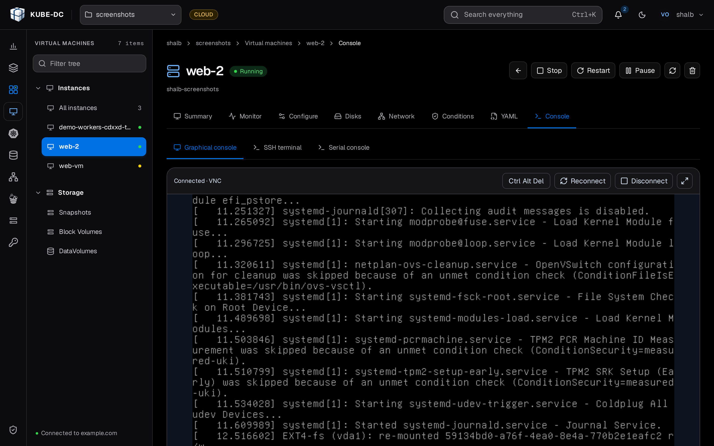

# Connect to your VM

This page is for a Project member who needs access to a virtual machine in Kube-DC. After you read it, you can open a browser console, connect over SSH, and use serial or VNC sessions with `virtctl`.

## Before you begin

You need:

- A running [virtual machine](creating-vm.md).
- [CLI access](cli-kubeconfig.md) configured, for the `kubectl` and `virtctl` methods.

---

## Console access in the web interface

The console gives you browser access to your VMs. It needs no SSH keys on your computer and no network configuration.

### Open a browser console

1. In the section rail, click **Virtual machines**.
2. Click the name of your VM. The detail page opens on the **Summary** tab.
3. Click the **Console** tab.
4. Click **Graphical console**, **SSH terminal**, or **Serial console**. The console connects, and the toolbar shows the connection state.



The **Console** tab works only while the VM is running. On a stopped or paused VM, it shows "Console available when the VM is running". On the **Summary** tab, the **Guest display** panel shows a preview of the screen, and **Open console** opens the **Console** tab.

The three console types do these things:

- **Graphical console**: opens a VNC session in your browser. Use it for VMs with a desktop environment, and when you need the boot process or the firmware. The toolbar has **Ctrl Alt Del**, **Reconnect**, **Disconnect**, and a fullscreen button.
- **SSH terminal**: opens a browser terminal that connects over SSH as the VM's guest login user. It is available only when the VM has a guest login user. The session stays connected while you move to other pages in the same browser tab. To open an independent session, click **Open in new tab**.
- **Serial console**: connects to the guest serial port. Sign in at the login prompt with the guest credentials.

### Guest credentials

To see the guest user name and password, open the VM's **Summary** tab and click **Reveal guest credentials**. The credentials hide after one minute. Use them at the login prompt of the graphical or serial console.

A VM that you created with kubectl has no console credentials unless you set them. To sign in at a console, add a user with a password:

1. Connect to the VM over SSH, or open a serial console with `virtctl console`.
2. Create the user with `useradd -m <username>`.
3. Set the password with `passwd <username>`.

Replace `<username>` with the name of the user. The user can then sign in at the graphical console with these credentials.

:::tip Pasting into the graphical console
To paste text, enter it in the **Type or paste text for the guest…** box under the graphical console, and click **Send text**. The console types the text as paced key events, so it works at firmware, installer, login, and Linux text-console screens where a guest clipboard does not exist. Newlines are sent as Enter and tabs as Tab.

**Send text** also performs standard VNC clipboard synchronization for graphical guests that support it. When the guest copies text, **Copy guest clipboard** appears next to **Send text**. Pressing Ctrl+V directly in a Linux TTY does not paste and may display `^V`. Use **Send text** there.
:::

---

## SSH access through a floating IP

For direct SSH access from your local machine, assign a [Floating IP](public-floating-ips.md) to your VM:

```yaml
apiVersion: kube-dc.com/v1
kind: FIp
metadata:
  name: my-vm-fip
spec:
  externalNetworkType: public
  vmTarget:
    vmName: ubuntu
    interfaceName: vpc_net_0
```

```bash
kubectl apply -f fip.yaml
kubectl get fip my-vm-fip
```

After the FIP is Ready, SSH directly to the external IP:

```bash
ssh ubuntu@198.51.100.16
```

For the complete FIP configuration, see [Deploy VMs](creating-vm.md#expose-a-vm-with-a-floating-ip).

---

## SSH access through a LoadBalancer Service

To expose SSH without a Floating IP, create a LoadBalancer Service.

### Use the default gateway EIP

For projects with `egressNetworkType: public`, the default gateway EIP is public:

```yaml
apiVersion: v1
kind: Service
metadata:
  name: vm-ssh
  annotations:
    service.nlb.kube-dc.com/bind-on-default-gw-eip: "true"
spec:
  type: LoadBalancer
  selector:
    vm.kubevirt.io/name: ubuntu
  ports:
  - name: ssh
    port: 2222
    targetPort: 22
```

### Use a dedicated public EIP

For projects with `egressNetworkType: cloud`, create a dedicated public EIP:

```yaml
apiVersion: kube-dc.com/v1
kind: EIp
metadata:
  name: vm-ssh-eip
spec:
  externalNetworkType: public
---
apiVersion: v1
kind: Service
metadata:
  name: vm-ssh
  annotations:
    service.nlb.kube-dc.com/bind-on-eip: "vm-ssh-eip"
spec:
  type: LoadBalancer
  selector:
    vm.kubevirt.io/name: ubuntu
  ports:
  - name: ssh
    port: 2222
    targetPort: 22
```

```bash
kubectl apply -f vm-ssh-service.yaml
kubectl get svc vm-ssh
```

Connect using the LoadBalancer IP and custom port:

```bash
ssh -p 2222 ubuntu@<loadbalancer-ip>
```

For more options, see [Service exposure](service-exposure.md).

---

## virtctl console access

The `virtctl` CLI gives you serial console access without network connectivity. Use it to troubleshoot network problems, and to reach a VM during boot.

### Install virtctl

Install a `virtctl` release compatible with the platform KubeVirt version. Follow the [official KubeVirt installation guide](https://kubevirt.io/user-guide/user_workloads/virtctl_client_tool/), which covers release binaries and the Krew plugin.

### Serial console

```bash
# Open interactive console (press Ctrl+] to exit)
virtctl console ubuntu

```

### VNC session

```bash
# Open the session in the configured VNC viewer
virtctl vnc ubuntu
```

To connect a viewer yourself, keep a proxy open on a known local port:

```bash
virtctl vnc ubuntu --proxy-only --port 5900
```

Then connect the viewer to `localhost:5900`.

### Kubernetes API tunneling

Standard Project roles do not include
`virtualmachineinstances/portforward`. Consequently, `virtctl ssh` and
`virtctl port-forward` are not tenant access methods on Kube-DC. Use the
browser SSH terminal, a Floating IP, or a LoadBalancer Service instead.
Platform operators can use API tunneling only when they hold a separate
diagnostic role that grants the subresource explicitly.

---

## Windows VMs: RDP and SSH

You reach a Windows VM the same way as a Linux VM, but the sign-in works
differently. Each way in gets its credential from a different mechanism.

**The account is `kube-dc`**, the same login name the rest of the platform uses. The
first boot creates it, so a VM that has only started might not have it yet. Give
the first boot a few minutes before you conclude that something is wrong.

The two ways in use these mechanisms:

| Method | How you connect | Where the credential comes from |
|---|---|---|
| **RDP** (port 3389) | Any RDP client, to the VM's floating IP | Password, set through the guest agent |
| **SSH** (port 22) | `ssh kube-dc@<floating-ip>` | Your project's SSH key, installed by cloudbase-init |

### RDP

Attach a floating IP to the VM, then point an RDP client at it:

```bash
kubectl get fip <vm-name> -o jsonpath='{.status.externalIP}'
```

- **macOS**: Windows App (formerly Microsoft Remote Desktop), from the App Store
- **Linux**: `xfreerdp /v:<floating-ip> /u:kube-dc` or Remmina
- **Windows**: `mstsc /v:<floating-ip>`

The platform generates the password when it creates the VM, and stores it in a Secret
next to the VM. To see it in the console, open the VM's **Summary** tab and click
**Reveal guest credentials**. To read it with the CLI, run:

```bash
kubectl get secret <vm-name>-console-credentials -o jsonpath='{.data}' | \
  python3 -c 'import sys,json,base64; d=json.load(sys.stdin); \
    print({k: base64.b64decode(v).decode() for k,v in d.items()})'
```

### SSH

SSH works as it does on Linux. Your Project key is installed into the
`kube-dc` account on first boot:

```bash
ssh -i ~/.ssh/<project-key> kube-dc@<floating-ip>
```

The default shell is PowerShell, so `ssh kube-dc@<ip> "Get-Service sshd"` behaves the
way you would expect.

### If Windows is not answering yet

A Windows first boot does more work than a Linux one. It specializes the
image, creates the account, applies the password and key, and **reboots once** partway
through. Until that finishes, RDP can answer while SSH does not, or the
reverse, because services start at different points and the machine reboots in between.

On slower (HDD-backed) storage, this takes considerably longer than on NVMe. Before
you conclude that a VM is broken, check the **Graphical console**. A VM that shows
"Getting devices ready" or "Starting services" is still working, not stuck.

## Connection method comparison

The connection methods compare as follows:

| Method | Use case | Requires network | Requires public IP |
|--------|----------|------------------|-------------------|
| **Graphical console** in the console | GUI access, troubleshooting boot | No | No |
| **SSH terminal** in the console | Quick terminal access | No | No |
| **Serial console** in the console | Serial access, boot access | No | No |
| **Floating IP** | Direct SSH from anywhere | Yes | Yes |
| **LoadBalancer** | Shared IP, custom port | Yes | Optional |
| **virtctl console** | Serial console, boot access | No | No |
| **virtctl vnc** | VNC through API tunnel | No | No |

---

## Troubleshooting

### SSH connection refused

- Verify guest agent is running: `kubectl get vmi ubuntu -o jsonpath='{.status.conditions[?(@.type=="AgentConnected")].status}'`
- Check if SSH keys are injected: `virtctl console ubuntu` and verify `~/.ssh/authorized_keys`
- Confirm SSH daemon is running inside the VM: `systemctl status sshd`

### VNC console black screen

- The VM might still be booting. Wait for the readiness probe to report True: `kubectl get vm ubuntu -o jsonpath='{.status.ready}'`
- Check if the VM has a graphical environment installed
- Try the serial console: `virtctl console ubuntu`

### You cannot reach the VM through its floating IP

- Verify FIP status: `kubectl get fip -o wide`
- Check if `externalIP` is assigned and `ready: true`
- Test connectivity from the VM to external network: `virtctl console ubuntu` then `ping 8.8.8.8`

---

## Next steps

- [VM lifecycle](vm-lifecycle.md): start, stop, and restart VMs
- [Public and floating IPs](public-floating-ips.md): Manage IP addresses
- [Service exposure](service-exposure.md): Expose VM services with HTTPS
