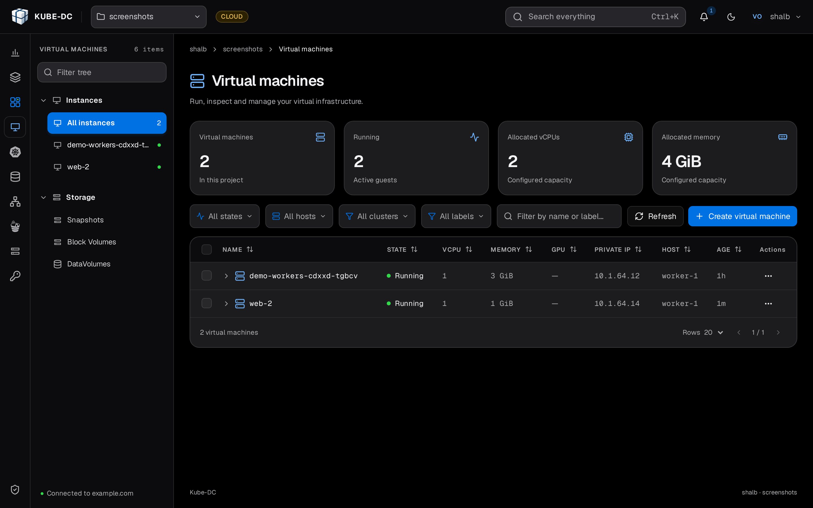
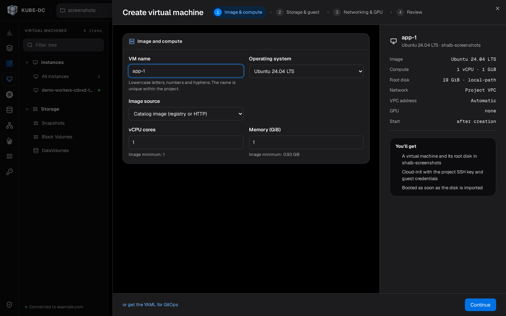
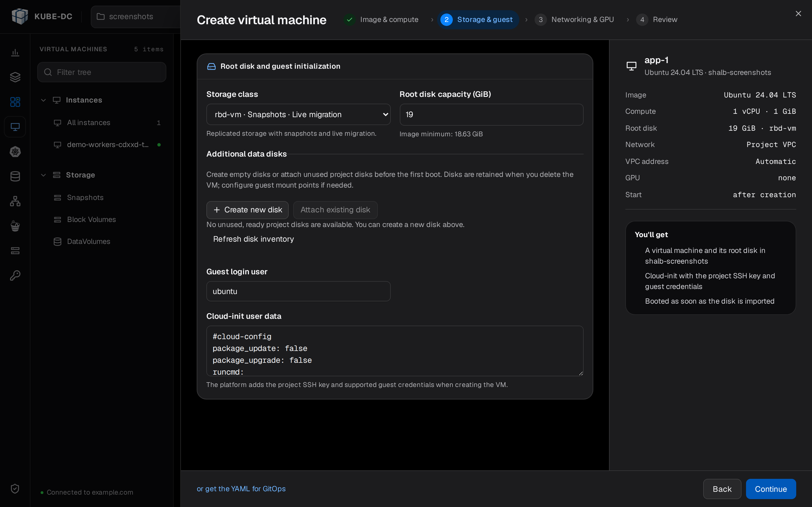
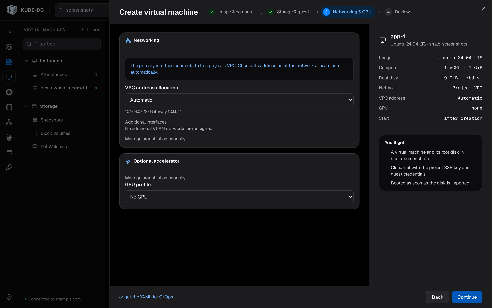
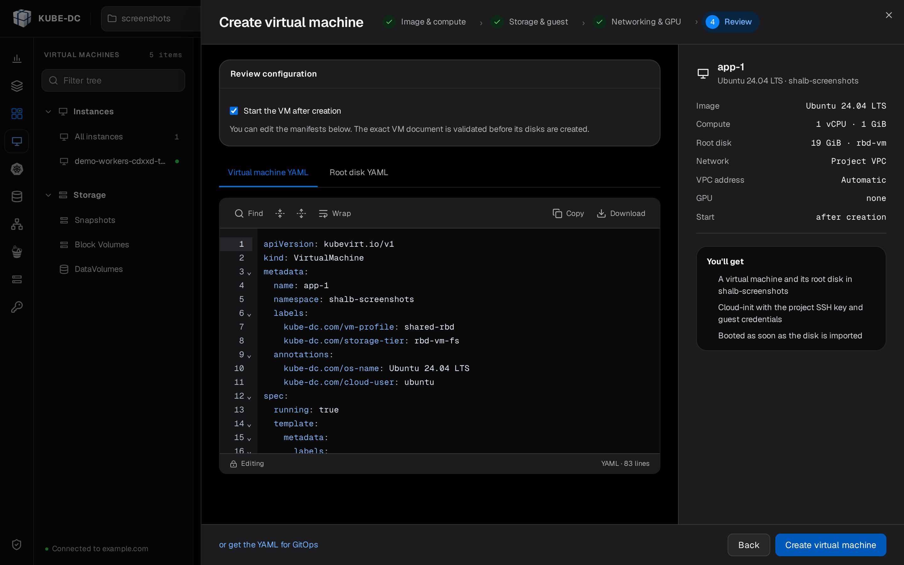
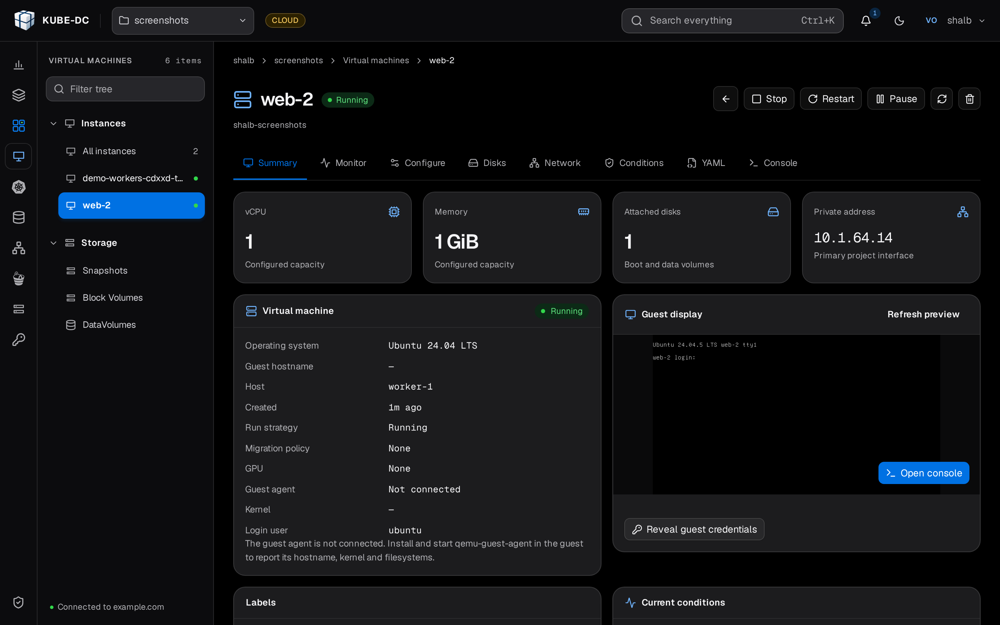

# Deploy VMs

This page is for a Project member who runs virtual machines in Kube-DC. After you read it, you can create a VM in the console or with kubectl manifests, choose its root disk storage, and expose it to the internet.

## Before you begin

You need:

- A Kube-DC [Project](first-project.md).
- [CLI access](cli-kubeconfig.md) configured, with `kubectl` working against your Project.
- Optional: the [`virtctl`](https://kubevirt.io/user-guide/user_workloads/virtctl_client_tool/) plugin for VM console access.

## VM components

Kube-DC virtualization uses [KubeVirt](https://kubevirt.io/) and three main resources:

- **DataVolume**: manages the VM's disk image. It downloads cloud images and provisions PVCs.
- **VirtualMachine**: defines the VM configuration, resources, and lifecycle.
- **VirtualMachineInstance (VMI)**: represents a running VM instance.

---

## Create a VM in the console

The console creates a VM in a sheet with four steps: **Image & compute**, **Storage & guest**, **Networking & GPU**, and **Review**. A panel on the right side of the sheet summarizes the VM as you fill in each step.

### Open the creation sheet

1. In the **Project** selector at the top of the console, select your Project.
2. In the section rail, click **Virtual machines**. The **Virtual machines** page lists your VMs with their state, vCPU, memory, private IP, and host.
3. Click **Create virtual machine**. The **Create virtual machine** sheet opens on the **Image & compute** step.



To move between steps, click **Continue** and **Back** at the bottom of the sheet. To copy the manifests for a GitOps repository instead of creating the VM in the console, click **or get the YAML for GitOps**.

### Choose the image and compute

1. In **VM name**, enter a name. Use lowercase letters, numbers, and hyphens. The name must be unique in the Project.
2. In **Operating system**, select an image from your installation's OS catalog.
3. In **Image source**, select where the root disk comes from. The options are listed after this procedure.
4. In **vCPU cores**, enter the number of virtual CPUs. The hint under the field shows the image minimum.
5. In **Memory (GiB)**, enter the memory size. The hint under the field shows the image minimum.
6. Click **Continue**. The **Storage & guest** step opens.



**Image source** offers these options:

- **Catalog image (registry or HTTP)**: imports the image that the OS catalog lists for the operating system. This is the default.
- **Custom image URL**: imports a bootable qcow2 or raw image from the HTTP or HTTPS address that you enter in **Disk image URL**. The address must not contain credentials.
- **Clone an existing project disk**: copies a Bound volume of your Project that you select in **Source disk**.
- **Prepared snapshot image**: restores the root disk from a prepared snapshot of the operating system that you select in **Prepared image**. The option shows `unavailable` when your installation has no prepared image for that operating system.

### Choose storage and guest settings

1. In **Storage class**, select where the root disk is stored. Each option shows the class name and what it supports: **Snapshots**, **Live migration**, or **Node-local**. For a prepared snapshot image, the image sets the class and the field is read-only. See [Root disk storage](#root-disk-storage).
2. In **Root disk capacity (GiB)**, enter the disk size. It must be at least the image minimum that the hint under the field shows.
3. Optional: under **Additional data disks**, click **Create new disk** to add an empty data disk.
4. Optional: under **Additional data disks**, click **Attach existing disk** to attach an unused disk of your Project.
5. In **Guest login user**, check the account name. The platform installs the Project SSH key for this account.
6. Optional: edit **Cloud-init user data**. The platform adds the Project SSH key and supported guest credentials when it creates the VM.
7. Click **Continue**. The **Networking & GPU** step opens.



The root disk capacity is a floor as well as a size. When you clone a disk or use a prepared snapshot image, the root disk must be at least as large as its source. Otherwise the console reports "The root disk must be at least as large as its source." The platform grows the disk to the size you request before the VM starts, and the guest filesystem expands into it on first boot. On Windows, that expansion happens during the first-boot sequence, so `C:` reaches its full size a few minutes after the VM is created.

Data disks that you add on this step stay in the Project when you delete the VM. **Guest login user** appears only for images that support SSH access. **Cloud-init user data** appears only for images that use a cloud-init disk.

### Choose networking and a GPU

1. In **VPC address allocation**, keep **Automatic** to let the network assign the address of the primary interface.
2. Optional: to set the address yourself, select **Choose an IPv4 address**. The **VPC address IPv4** field appears.
3. Optional: in **VPC address IPv4**, enter the address. The console checks the address again when it creates the VM.
4. Optional: under **Additional interfaces**, select a VLAN network that is assigned to your Project. When none is assigned, the step shows "No additional VLAN networks are assigned."
5. Optional: in **GPU profile**, select a Dedicated GPU VM profile. Keep **No GPU** for an ordinary VM.
6. Optional: in **Number of GPUs**, enter the number of GPUs. The hint under the field shows the maximum available.
7. Click **Continue**. The **Review** step opens.



The **GPU profile** field is available only when your installation enables Dedicated GPU VM passthrough for your Project. Shared GPU (HAMi) pod capacity does not enable it. A GPU VM cannot live migrate, so maintenance on its node requires a shutdown and a restart. After first boot, follow the [guest driver and lifecycle guide](gpu-vm-guests.md).

### Review and create the VM

1. Optional: clear **Start the VM after creation** to leave the VM stopped after the console creates it.
2. Optional: review or edit the manifests on the **Virtual machine YAML** and **Root disk YAML** tabs. When you create data disks on the **Storage & guest** step, the second tab is **Disk YAML**.
3. Click **Create virtual machine**. The console opens the detail page of the VM.



The console validates the edited VM document before it creates the VM's disks. Wait until the VM state is **Running**.

### Manage a VM in the console

To open a VM's detail page, click its name on the **Virtual machines** page.



The detail page has these tabs: **Summary**, **Monitor**, **Configure**, **Disks**, **Network**, **Conditions**, **YAML**, and **Console**. The buttons at the top of the page start, stop, restart, pause, resume, and delete the VM. The buttons that show depend on the VM state.

- To open a browser console, click the **Console** tab. See [Connect to your VM](connecting-vm.md).
- To see the guest password, click **Reveal guest credentials** on the **Summary** tab.
- To change the VM from the list, open the row's **Actions** menu and select **Configure**, **Edit YAML**, or **Delete**.

---

## Create a VM with kubectl

The following resources are created in your active Project. Multus requires a
Kubernetes-qualified network name, so replace `<project-backing-namespace>`
with the current Project's backing namespace. You can print it with
`kubectl config view --minify -o jsonpath='{..namespace}'`.

### Size a VM near your plan's maximum

Your plan sets a maximum CPU and memory per workload; the console shows them
on the Project overview. A VM may use exactly that maximum. Every VM also
needs some CPU and memory for the virtualization that runs alongside it.
Kube-DC adds room for this to your plan's limits and to your organization's
quota, so a VM at the maximum starts when the rest of your quota is free.
Workloads that are already running use part of the quota. Then a VM at the
maximum does not fit, and the console says how much is left.

If your administrator set a project quota equal to the plan, the project has
no room for this overhead: size the VM a little below the maximum, or ask for
a larger project quota.

For a VM close to the maximum, set its resource limits explicitly in the
manifest, equal to its size. Without explicit limits, KubeVirt sets a memory
limit of about twice the requested memory, which can exceed your plan:

```yaml
spec:
  template:
    spec:
      domain:
        cpu:
          cores: 16
        memory:
          guest: 56Gi
        resources:
          requests:
            cpu: "16"
            memory: 56Gi
          limits:
            cpu: "16"
            memory: 56Gi
```

VMs created in the console already set their limits.

### Ubuntu 24.04

<details>
<summary>Ubuntu 24.04: DataVolume and VirtualMachine manifest</summary>

```yaml
apiVersion: cdi.kubevirt.io/v1beta1
kind: DataVolume
metadata:
  name: ubuntu-root
spec:
  pvc:
    accessModes:
    - ReadWriteOnce
    resources:
      requests:
        storage: 12G
    storageClassName: local-path
  source:
    http:
      url: https://cloud-images.ubuntu.com/noble/current/noble-server-cloudimg-amd64.img
---
apiVersion: kubevirt.io/v1
kind: VirtualMachine
metadata:
  name: ubuntu
spec:
  running: true
  template:
    spec:
      networks:
      - name: vpc_net_0
        multus:
          default: true
          networkName: <project-backing-namespace>/default
      domain:
        cpu:
          cores: 1
        memory:
          guest: 1G
        devices:
          interfaces:
          - name: vpc_net_0
            bridge: {}
          disks:
          - name: root-volume
            disk:
              bus: virtio
          - name: cloudinitdisk
            disk:
              bus: virtio
      accessCredentials:
      - sshPublicKey:
          source:
            secret:
              secretName: authorized-keys-default
          propagationMethod:
            qemuGuestAgent:
              users:
              - ubuntu
      readinessProbe:
        guestAgentPing: {}
        failureThreshold: 10
        initialDelaySeconds: 30
        periodSeconds: 10
        timeoutSeconds: 5
      volumes:
      - name: root-volume
        dataVolume:
          name: ubuntu-root
      - name: cloudinitdisk
        cloudInitNoCloud:
          userData: |
            #cloud-config
            package_update: true
            package_upgrade: true
            packages:
              - qemu-guest-agent
            runcmd:
              - systemctl enable --now qemu-guest-agent
```

</details>

```bash
kubectl apply -f ubuntu-vm.yaml
```

:::tip SSH key injection
The `accessCredentials` section injects your SSH public key from the `authorized-keys-default` secret into the VM through the QEMU guest agent. The `users` field must match the default user for the OS image (`ubuntu` for Ubuntu, `debian` for Debian).
:::

### Access a VM with SSH

After the VM is running, you can connect to it over SSH with the private key in your Project's `ssh-keypair-default` secret.

#### Extract the SSH private key

To save the private key to a local file, run:

```bash
# Extract the private key from the secret
kubectl get secret ssh-keypair-default -n <project-backing-namespace> -o jsonpath='{.data.id_rsa}' | base64 -d > /tmp/vm_ssh_key
chmod 600 /tmp/vm_ssh_key
```

#### Get the VM's IP address

For a VM with a Floating IP (FIP), read the external IP:

```bash
# Get the external IP from the FIP resource
kubectl get fip -n <project-backing-namespace>
```

For a VM without a FIP (internal access only), read the internal IP:

```bash
# Get the internal IP from the VMI
kubectl get vmi <vm-name> -n <project-backing-namespace> -o jsonpath='{.status.interfaces[0].ipAddress}'
```

#### Connect over SSH

To connect with the extracted key, run:

```bash
# SSH using the extracted private key
ssh -i /tmp/vm_ssh_key <username>@<ip-address>

# Examples:
# Ubuntu VM: ssh -i /tmp/vm_ssh_key ubuntu@198.51.100.9
# Debian VM: ssh -i /tmp/vm_ssh_key debian@10.0.0.131
```

:::info Default users
- **Ubuntu**: `ubuntu`
- **Debian**: `debian`
- **Windows**: `kube-dc`
:::

### Debian 12

<details>
<summary>Debian 12: DataVolume and VirtualMachine manifest</summary>

```yaml
apiVersion: cdi.kubevirt.io/v1beta1
kind: DataVolume
metadata:
  name: debian-root
spec:
  pvc:
    accessModes:
    - ReadWriteOnce
    resources:
      requests:
        storage: 20G
    storageClassName: local-path
  source:
    http:
      url: https://cloud.debian.org/images/cloud/bookworm/latest/debian-12-generic-amd64.qcow2
---
apiVersion: kubevirt.io/v1
kind: VirtualMachine
metadata:
  name: debian
spec:
  running: true
  template:
    spec:
      networks:
      - name: vpc_net_0
        multus:
          default: true
          networkName: <project-backing-namespace>/default
      domain:
        cpu:
          cores: 1
        memory:
          guest: 1G
        devices:
          interfaces:
          - name: vpc_net_0
            bridge: {}
          disks:
          - name: root-volume
            disk:
              bus: virtio
          - name: cloudinitdisk
            disk:
              bus: virtio
      accessCredentials:
      - sshPublicKey:
          source:
            secret:
              secretName: authorized-keys-default
          propagationMethod:
            qemuGuestAgent:
              users:
              - debian
      readinessProbe:
        guestAgentPing: {}
        failureThreshold: 10
        initialDelaySeconds: 30
        periodSeconds: 10
        timeoutSeconds: 5
      volumes:
      - name: root-volume
        dataVolume:
          name: debian-root
      - name: cloudinitdisk
        cloudInitNoCloud:
          userData: |
            #cloud-config
            package_update: true
            package_upgrade: true
            packages:
              - qemu-guest-agent
            runcmd:
              - systemctl enable --now qemu-guest-agent
```

</details>

### Windows 11

To create a Windows VM in the console, follow [Create a VM in the console](#create-a-vm-in-the-console) with these choices:

1. In **Operating system**, select the Windows 11 entry of your OS catalog.
2. In **Root disk capacity (GiB)**, enter at least the image minimum that the hint under the field shows.
3. After the VM is **Running**, open its detail page and click the **Console** tab.
4. Click **Graphical console**. The Windows lock screen appears.

The Windows golden image has the VirtIO drivers, the QEMU guest agent, SSH, and RDP installed. The platform applies the UEFI, TPM, and Hyper-V settings that the OS catalog defines for Windows. The VM reaches the Windows lock screen a few minutes after it starts.

:::tip Storage quota
A Windows golden image is about 75 GB, so its root disk needs **75–80 GB of free storage quota** in your Project. If the Project is near its storage limit, the disk creation fails with a quota error. Free space, or request more, before you create a Windows VM.
:::

The kubectl equivalent shows the UEFI boot, TPM, and Hyper-V features that Windows requires:

<details>
<summary>Windows 11: DataVolume and VirtualMachine manifest</summary>

```yaml
apiVersion: cdi.kubevirt.io/v1beta1
kind: DataVolume
metadata:
  name: win-root
spec:
  pvc:
    accessModes:
    - ReadWriteOnce
    resources:
      requests:
        storage: 70G
    storageClassName: local-path
  source:
    http:
      # The golden image published to your cluster's S3 OS-image mirror.
      # Replace <cluster-domain> with the domain of your installation.
      url: https://s3.<cluster-domain>/cdi-os-images/private/windows/11/latest/windows11-x64-golden.qcow2
---
apiVersion: kubevirt.io/v1
kind: VirtualMachine
metadata:
  name: win
spec:
  running: true
  template:
    spec:
      networks:
      - name: vpc_net_0
        multus:
          default: true
          networkName: <project-backing-namespace>/default
      domain:
        cpu:
          cores: 2
          model: host-model
        memory:
          guest: 8G
        features:
          acpi: {}
          apic: {}
          hyperv:
            frequencies: {}
            relaxed: {}
            reset: {}
            runtime: {}
            spinlocks:
              spinlocks: 8191
            synic: {}
            vapic: {}
            vpindex: {}
          smm:
            enabled: true
        firmware:
          bootloader:
            efi:
              persistent: true
              secureBoot: false
        devices:
          interfaces:
          - name: vpc_net_0
            bridge: {}
          disks:
          - name: root-volume
            disk:
              bus: virtio
          - name: cloudinitdisk
            disk:
              bus: virtio
          tpm:
            persistent: true
      accessCredentials:
      - sshPublicKey:
          source:
            secret:
              secretName: authorized-keys-default
          propagationMethod:
            qemuGuestAgent:
              users:
              - kube-dc
      readinessProbe:
        guestAgentPing: {}
        failureThreshold: 10
        initialDelaySeconds: 30
        periodSeconds: 10
        timeoutSeconds: 5
      volumes:
      - name: root-volume
        dataVolume:
          name: win-root
      - name: cloudinitdisk
        cloudInitNoCloud:
          userData: ""
```

</details>

:::note Windows images
Windows cloud images must be prepared with the VirtIO drivers and the QEMU guest agent installed. To prepare golden images, see [Managing OS images](/platform/managing-os-images) and [Windows VM setup](/platform/windows-vm-setup).
:::

---

## Root disk storage

The main storage decision for a VM is where its root disk lives. You make it in **Storage class** on the **Storage & guest** step. Each option shows what the class supports:

| Label on the option | What you get | Trade-off |
|---|---|---|
| **Node-local** | Storage on the disk of one node, with the best durable-write latency. | The disk stays on its host. There is no live migration, and a node drain stops the VM. Snapshots, if the class supports them, stay on that host. |
| **Snapshots** | Replicated storage that supports volume snapshots. | Higher durable-write latency for fsync-heavy workloads. |
| **Live migration** | Replicated storage that can hold a live-migratable VM. | Higher durable-write latency for fsync-heavy workloads. |

The decision comes down to one question: do you want the fastest disk writes, or the shared-storage features (snapshots and live migration)? A node-local disk cannot live migrate, because it belongs to one node. That limit is inherent, not a policy.

A VM is live-migratable only when you create it from a prepared snapshot image in `Block` volume mode and select a CPU compatibility pool. A GPU VM is never live-migratable.

Operators find the cluster-side mechanics (storage tiers, enabling RBD, migration pools, and the CPU-headroom rule) in [VM storage tiers and live migration](/platform/vm-storage-tiers).

### Create a live-migratable VM

1. Open the **Create virtual machine** sheet. See [Open the creation sheet](#open-the-creation-sheet).
2. In **Operating system**, select the operating system.
3. In **Image source**, select **Prepared snapshot image**.
4. In **Prepared image**, select an image whose option shows `Block`.
5. Click **Continue**.
6. Select **Enable live migration (shared Block disk and compatible CPU pool)**.
7. In **CPU compatibility pool**, select a pool. Each option shows the CPU vendor, the CPU model, and the number of compatible hosts.
8. Click **Continue**.
9. In **GPU profile**, keep **No GPU**.
10. Click **Continue**. The **Review** step opens.
11. Click **Create virtual machine**.

The checkbox is unavailable when the platform reports no CPU compatibility pool, or when you selected a GPU profile. The VM comes up live-migratable. During node maintenance, Kube-DC can live migrate it to another compatible node. Application availability still depends on the health of the guest, the storage, the network, and the migration.

:::warning CPU headroom for migration
A live migration briefly runs **two copies** of the VM (source and target) while memory
is copied. Keep **free CPU quota of at least the VM's CPU count**, or a migration waits until
you free capacity. Prefer smaller HA VMs, or migrate them one at a time.
:::

### The generated manifest

A live-migratable VM is made of explicit KubeVirt resources. No mutating webhook
changes them. Kube-DC also adds two descriptive labels
(`kube-dc.com/vm-profile` and `kube-dc.com/storage-tier`) so the choice is visible in
`kubectl`, but **nothing depends on them**. The spec fields are the source of
truth. You can write the same manifest by hand:

<details>
<summary>Ubuntu 24.04: live-migratable VM (generated manifest)</summary>

```yaml
# Root disk: an RWX Block clone of the OS's Block golden snapshot.
# accessModes: ReadWriteMany + volumeMode: Block + storageClassName: rbd-vm
# are what make the disk (and therefore the VM) live-migratable.
apiVersion: v1
kind: PersistentVolumeClaim
metadata:
  name: ubuntu-root
  labels:
    kube-dc.com/vm-profile: migratable       # descriptive only
    kube-dc.com/storage-tier: rbd-vm-block    # descriptive only
spec:
  accessModes:
  - ReadWriteMany
  volumeMode: Block
  storageClassName: rbd-vm
  resources:
    requests:
      storage: 12Gi
  dataSource:
    apiGroup: snapshot.storage.k8s.io
    kind: VolumeSnapshot
    name: golden-ubuntu-24-04-block   # the per-project Block golden snapshot
---
apiVersion: kubevirt.io/v1
kind: VirtualMachine
metadata:
  name: ubuntu
  labels:
    kube-dc.com/vm-profile: migratable
    kube-dc.com/storage-tier: rbd-vm-block
spec:
  running: true
  template:
    spec:
      evictionStrategy: LiveMigrate    # drain a node ⇒ live-migrate, don't kill
      networks:
      - name: vpc_net_0
        multus:
          default: true
          networkName: <project-backing-namespace>/default
      domain:
        cpu:
          cores: 1
          model: Skylake-Server-IBRS   # pinned to the migration pool's CPU model
        memory:
          guest: 2G
        devices:
          interfaces:
          - name: vpc_net_0
            bridge: {}
          disks:
          - name: root-volume
            disk:
              bus: virtio
          - name: cloudinitdisk
            disk:
              bus: virtio
      accessCredentials:
      - sshPublicKey:
          source:
            secret:
              secretName: authorized-keys-default
          propagationMethod:
            qemuGuestAgent:
              users:
              - ubuntu
      volumes:
      - name: root-volume
        persistentVolumeClaim:
          claimName: ubuntu-root
      - name: cloudinitdisk
        cloudInitNoCloud:
          userData: |
            #cloud-config
            packages:
              - qemu-guest-agent
            runcmd:
              - systemctl enable --now qemu-guest-agent
```

</details>

The three facts that make it migratable are the PVC's `ReadWriteMany` + `Block` +
`rbd-vm`, the VM's `evictionStrategy: LiveMigrate`, and the pinned `cpu.model`. Verify
with:

```bash
kubectl get vmi ubuntu -n <project-backing-namespace> \
  -o jsonpath='{range .status.conditions[*]}{.type}={.status} {end}'
# Expected: LiveMigratable=True StorageLiveMigratable=True
```

### Monitor VM status

```bash
# List VMs
kubectl get vm

# Watch a VM come up
kubectl get vm -w

# Check running instances and IP addresses
kubectl get vmi
```

---

## Expose a VM with a floating IP

Floating IPs (FIPs) map a public address to a VM through one-to-one NAT. The FIP resolves the VM's internal IP through the QEMU guest agent, so you do not look up IP addresses by hand.

```yaml
apiVersion: kube-dc.com/v1
kind: FIp
metadata:
  name: debian-fip
spec:
  externalNetworkType: public
  vmTarget:
    vmName: debian
    interfaceName: vpc_net_0
```

```bash
kubectl apply -f debian-fip.yaml
```

Check the assigned external IP:

```bash
kubectl get fip
```

```
NAME         TARGET IP    EXTERNAL IP    VM       INTERFACE   READY
debian-fip   10.0.0.131   198.51.100.16   debian   vpc_net_0   true
```

Connect to the VM over SSH:

```bash
ssh debian@198.51.100.16
```

:::tip No EIP required
When a FIP uses `externalNetworkType: public`, the platform allocates and binds a dedicated public EIP. You do not create an EIP separately.
:::

### Expose VM ports with a LoadBalancer Service

To expose specific ports (for example, SSH on a non-standard port) without a dedicated public IP, create a LoadBalancer Service:

```yaml
apiVersion: v1
kind: Service
metadata:
  name: ubuntu-ssh
  annotations:
    service.nlb.kube-dc.com/bind-on-default-gw-eip: "true"
spec:
  type: LoadBalancer
  selector:
    vm.kubevirt.io/name: ubuntu
  ports:
  - name: ssh
    port: 2222
    targetPort: 22
```

This binds to the Project's shared EIP. Connect to:

```bash
ssh -p 2222 ubuntu@<project-eip>
```

For more options, including HTTPS routes and dedicated EIPs, see [Service exposure](service-exposure.md).

---

## Best practices

- **Use SSH keys**: the `authorized-keys-default` secret is auto-created per project; add your public keys there
- **Enable guest agent**: always include `qemu-guest-agent` in cloud-init for proper IP reporting, readiness probes, and SSH key injection
- **Right-size resources**: Linux VMs typically need 1 vCPU / 1 GB RAM minimum; Windows needs 2 vCPUs / 8 GB RAM
- **Use readiness probes**: `guestAgentPing` ensures the VM is fully booted before being marked Ready

## Troubleshooting

| Issue | Check |
|-------|-------|
| VM stuck in provisioning | Run `kubectl get dv` to check the DataVolume download progress |
| VM running but not Ready | Run `kubectl get vmi` to verify that the guest agent is connected |
| No IP assigned | Check `networkName` matches your project's default network |
| SSH key not injected | Verify `authorized-keys-default` secret exists and guest agent is running |
| Docker in the VM: `git clone` / `docker pull` / `apt-get` hangs then fails, but `curl` works | Docker's default MTU (1500) is larger than the Project network's MTU (1400 by default). Set `{"mtu": 1400}`, or the value `ip link show` reports, in `/etc/docker/daemon.json`, then restart Docker. See [Network MTU](networking-overview.md#network-mtu) |

```bash
# Check events for errors
kubectl get events --sort-by=.lastTimestamp

# Access VM console directly
virtctl console ubuntu

# Find the launcher pod, then inspect its compute-container log
kubectl get pods -l kubevirt.io/domain=ubuntu
kubectl logs <virt-launcher-pod> -c compute
```

## Next steps

- [Connect to your VM](connecting-vm.md): browser consoles, SSH, and remote console options
- [VM lifecycle](vm-lifecycle.md): Start, stop, and restart VMs
- [Block storage](block-storage.md): Storage classes, disks and volumes
- [Service exposure](service-exposure.md): Expose VM services to the internet
- [Public and floating IPs](public-floating-ips.md): Manage IP addresses
