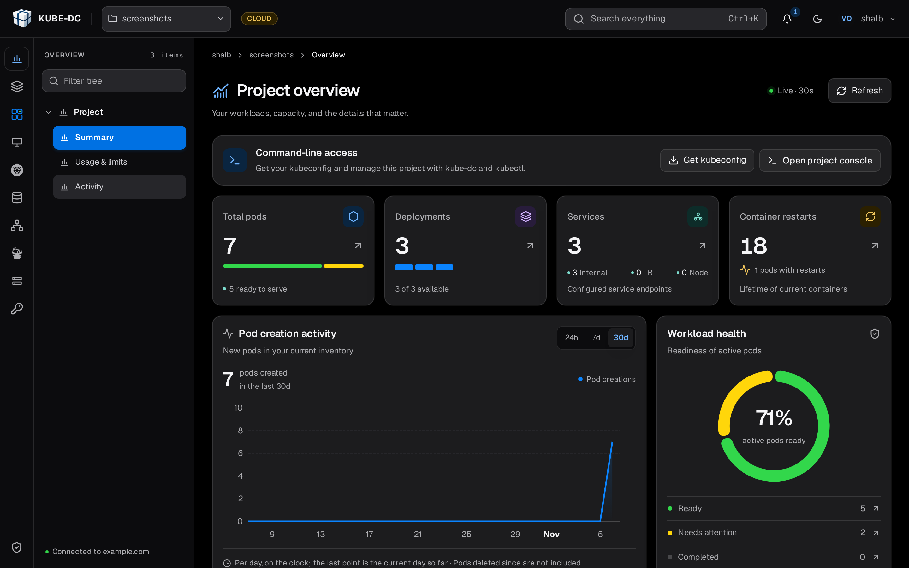
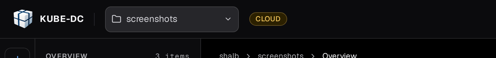
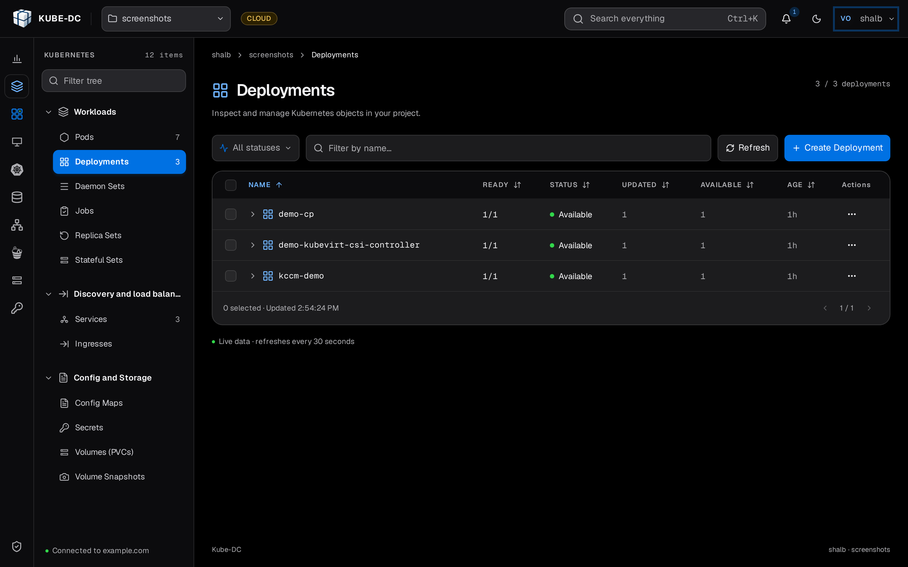
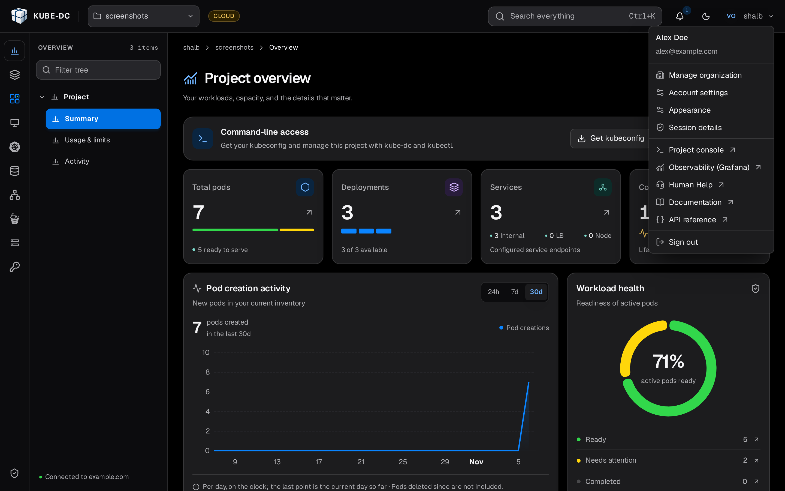
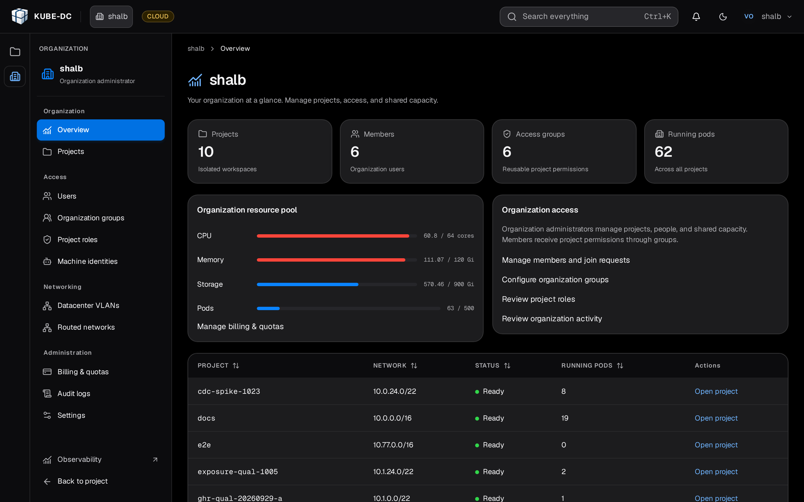

This page is for every member of an Organization. It shows how the Kube-DC
web console is laid out, how to move between Projects and resource sections,
and where to find Organization management and your account settings.

## Console layout

The console has four areas:

- **Top bar**: the Project selector, **Search everything** (`Ctrl+K`, or `⌘K`
  on macOS), notifications, the light and dark theme switch, and the account
  menu.
- **Section rail**: a column of icons on the left. Each icon opens one
  resource section of the current Project.
- **Section tree**: the pages of the selected section, with a **Filter tree**
  box.
- **Main panel**: the selected page, with a breadcrumb trail above it.

## Project overview

After you sign in, the console opens the **Project overview** of your current
Project.

The overview section tree has these pages:

- **Summary**: the **Command-line access** card, workload counts (pods,
  Deployments, Services, and container restarts), pod creation activity, and
  workload health.
- **Quota** or **Usage & limits**: what the Project uses against its limits.
  Organization Admins of a pay-as-you-go Organization see **Usage & limits**.
  All other members see **Quota**.
- **Activity**: pod creation history and recently created workloads.

The **Command-line access** card has two buttons:

- **Get kubeconfig** opens the **Set up CLI access** dialog. See
  [CLI, console, and IDE access](cli-kubeconfig.md).
- **Open project console** opens a web terminal in a separate browser tab. See
  [Project console](#project-console).

## Switch Projects

The Project selector is the dropdown next to the logo. It shows the
name of the current Project.

To switch Projects, open the Project selector and select another Project. The
console keeps the current section open for the Project you select.

## Resource sections

The section rail switches between resource sections of the current Project.
Hold the pointer over an icon to see its name. Some sections appear only when
your provider turns them on.

The following table lists the sections from top to bottom:

| Section | What you find there |
|---|---|
| **Overview** | The Project summary, usage and limits, and activity |
| **Kubernetes** | Workloads, discovery and load balancing, and configuration and storage objects |
| **Managed services** | Managed databases, caches, and other services from your provider's catalog |
| **Virtual machines** | Virtual machine instances and their storage |
| **Managed clusters** | Managed Clusters and their node pools |
| **Databases** | Databases from the earlier database service, where your provider still offers it |
| **Networking** | External IPs, Floating IPs, Load Balancers, Datacenter VLANs, and Routed Networks |
| **Object Storage** | S3-compatible buckets and access keys |
| **Block Storage** | Volumes and snapshots |
| **Security** | Managed secrets, certificates, KMS keys, database credentials, and the security audit |

The **Kubernetes** section tree groups resources in three parts:

- **Workloads**: **Pods**, **Deployments**, **Daemon Sets**, **Jobs**,
  **Replica Sets**, and **Stateful Sets**.
- **Discovery and load balancing**: **Services** and **Ingresses**.
- **Config and Storage**: **Config Maps**, **Secrets**, **Volumes (PVCs)**, and
  **Volume Snapshots**.

## Account menu

To open the account menu, click the avatar and Organization name in the top
right corner.

The following table lists the menu items. Some items appear only for some
roles or installations:

| Menu item | Description |
|---|---|
| **Manage organization** | Opens Organization management. Only Organization Admins see it. |
| **Account settings** | Opens your account page for profile, password, and two-factor authentication |
| **Appearance** | Changes the console theme, if your provider permits it |
| **Session details** | Shows your account, Organization, Projects, and when your access token expires |
| **Project console** | Opens a web terminal for the current Project in a separate tab |
| **Observability (Grafana)** | Opens Grafana with the metrics and logs of your Projects |
| **Human Help** | Opens your provider's support page |
| **Documentation** | Opens the documentation |
| **API reference** | Opens the API reference, if your provider publishes one |
| **Sign out** | Signs you out of the console |

## Organization management

You need the Organization Admin role. To open Organization management, open the
account menu and select **Manage organization**.

The **Overview** page shows the Project, member, group, and running pod
counts, the Organization resource pool, and the list of Projects. The
navigation on the left has these pages:

- **Organization**: **Overview** and **Projects**.
- **Access**: **Users**, **Organization groups**, **Project roles**, and
  **Machine identities**.
- **Networking**: **Datacenter VLANs**, **Routed networks**, and **Domains**.
  **Domains** appears only when your provider requires verified domains.
- **Administration**: **Billing & quotas**, **Event webhooks**, **Audit logs**,
  and **Settings**. Depending on your provider, **Billing & quotas** is named
  **Resources** or **Capacity**.

To return to your Projects, click **Back to project** at the bottom of the
navigation. You can also select **Project workspace** in the account menu.

## Project console

The Project console is a web terminal with a signed-in `kubectl` session for
your Projects. You do not need to install any tool on your computer.

To open the Project console, do one of these actions:

- On the **Summary** page, click **Open project console**.
- In the account menu, select **Project console**.

In the console, run `kube-dc use` to list and switch Project contexts. For the
tools and aliases in the console, see
[CLI, console, and IDE access](cli-kubeconfig.md#project-console-web-terminal).

## Account settings

To change your password or set up two-factor authentication, open the account
menu and select **Account settings**. Your account page opens. Then click
**Signing in**.

### Change your password

1. Under **Basic authentication**, click **Update** next to your password.
2. Enter a new password and confirm it.

### Set up two-factor authentication

1. Under **Two-factor authentication**, click **Set up Authenticator
   application**.
2. Scan the code with an authenticator app, such as Google Authenticator or
   Authy.
3. Enter the one-time code from the app.

After setup, Kube-DC asks for a code from the app at every sign-in.

:::tip
Turn on two-factor authentication to protect your account, above all for
Organization Admins.
:::

## Next steps

- [Core concepts](core-concepts.md) explains Organizations, Projects, and
  resource isolation.
- [Create your first Project](first-project.md) sets up your first Project.
- [CLI and kubeconfig access](cli-kubeconfig.md) covers the command line.
- [Team management](team-management.md) covers users and roles.
