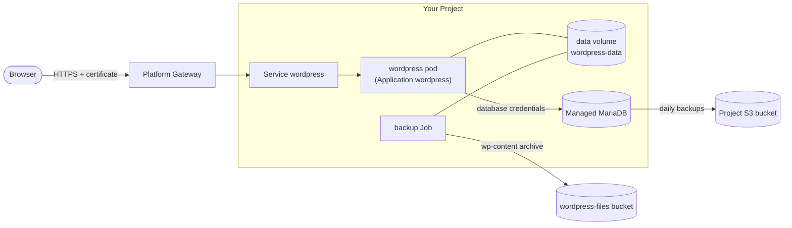

import WordPressStackDiagram from '@site/src/components/Diagram/WordPressStackDiagram';

# Deploy a full WordPress stack

This guide runs WordPress in a Kube-DC Project as an
[Application](applications.md), with the platform's managed services:

- a **managed MariaDB** database with daily backups;
- **database credentials** delivered to a Secret, which the app reads;
- a **data volume** for `/var/www/html` (themes, plugins and uploads);
- an **HTTPS address** with a certificate the platform issues;
- a headless install with **WP-CLI in a Job**;
- optionally, **S3 object storage** for archives of the files.

<details data-github-only>
<summary>Diagram source for GitHub</summary>



</details>

<WordPressStackDiagram />

## Before you begin

- A [Project](first-project.md) with enough CPU, memory, storage and
  object-storage quota.
- [CLI access](cli-kubeconfig.md), with `kubectl` connected to the Project.
  The manifests below have no namespace: `kubectl` applies them to the
  Project's namespace.
- The Project `admin` role: the guide creates Secrets and managed services.

## Step 1: the database

Create a managed MariaDB and deliver its owner credential as a Secret with a
`ServiceBinding`:

```yaml title="01-database.yaml"
apiVersion: services.kube-dc.com/v1alpha1
kind: ManagedService
metadata:
  name: wordpress-db              # not "wordpress": see the note below
spec:
  classRef:
    name: mariadb
  planRef:
    name: mariadb-development     # one server; mariadb-production for a Galera cluster
  placement:
    mode: ProviderShared
  connectivity:
    classRef:
      name: tenant-native
  compute:
    cpu: 500m
    memory: 1Gi
  storage:
    size: 10Gi
  parameters:
    database: wordpress
  deletionPolicy: Retain          # a delete keeps the database: see Clean up
---
apiVersion: services.kube-dc.com/v1alpha1
kind: ServiceBinding
metadata:
  name: wordpress-db-password
spec:
  serviceRef:
    name: wordpress-db
  role: owner
  consumer:
    kind: ServiceAccount
    name: default
  delivery:
    secretName: wordpress-db-password
```

```bash
kubectl apply -f 01-database.yaml
kubectl get managedservice wordpress-db -w            # PHASE: Ready
kubectl get servicebinding wordpress-db-password      # READY: True
```

The database takes 5 to 6 minutes to become `Ready`: the platform starts
it and takes a first backup. The binding is ready a few minutes earlier.

The binding pins the service it found by name; add `serviceUID` to pin a
specific instance. The Secret `wordpress-db-password` holds `host`, `port`,
`database`, `username`, `password`, `uri`, `jdbcUrl`, `tls` and `ca.crt`. In
the console, choosing **Kubernetes Secret** on the last step of the
database's creation sheet makes the same binding.

:::caution Name the database differently from the app
The platform creates Services named after the `ManagedService` (here
`wordpress-db…`), and the Application creates a Service named after the app
(`wordpress`). Give them different names so they don't collide.
:::

## Step 2: WordPress

```yaml title="02-wordpress.yaml"
apiVersion: apps.kube-dc.com/v1alpha1
kind: Application
metadata:
  name: wordpress
spec:
  source:
    image:
      reference: wordpress:6.8-apache
  run:
    port: 80
    healthPath: /wp-includes/images/blank.gif
    resources:
      cpu: "1"
      memory: 768Mi
    volume:
      path: /var/www/html
      size: 10Gi
      storageClass: rbd-vm               # a replicated class: see kubectl get storageclass
    env:
      - name: WORDPRESS_DB_HOST
        secretKeyRef: { name: wordpress-db-password, key: host }
      - name: WORDPRESS_DB_USER
        secretKeyRef: { name: wordpress-db-password, key: username }
      - name: WORDPRESS_DB_PASSWORD
        secretKeyRef: { name: wordpress-db-password, key: password }
      - name: WORDPRESS_DB_NAME
        secretKeyRef: { name: wordpress-db-password, key: database }
      - name: WORDPRESS_CONFIG_EXTRA     # the managed database accepts TLS connections only
        value: |
          define('MYSQL_CLIENT_FLAGS', MYSQLI_CLIENT_SSL | MYSQLI_CLIENT_SSL_DONT_VERIFY_SERVER_CERT);
    restartOnSecretChange: true          # new database credentials restart the pod
  deletionPolicy:
    volume: Retain                       # keep the files if the app is deleted
```

```bash
kubectl apply -f 02-wordpress.yaml
kubectl wait --for=condition=Ready app/wordpress --timeout=10m
kubectl get app wordpress                # STATUS: Ready, and the URL
```

The platform creates the volume `wordpress-data`, a Deployment and a Service
named `wordpress`, and an HTTPS address on the shared gateway with its own
certificate (1 to 3 minutes). No public IP is used. To serve the site on your
own domain, see [Use your own domain](applications.md#use-your-own-domain).

The managed MariaDB accepts only TLS connections. WordPress asks for TLS
through `MYSQL_CLIENT_FLAGS`, set here in `WORDPRESS_CONFIG_EXTRA`. The
connection is encrypted, but WordPress cannot check the server's certificate
against `ca.crt`, so the flag also turns that check off. HTTPS itself ends
at the platform's gateway, which the WordPress image already recognizes from
the `X-Forwarded-Proto` header.

Use a replicated storage class for the volume, such as Ceph block storage
(`rbd-vm` here); the class is set when the volume is created. An app with a
data volume runs one pod: the volume attaches to one node, and a new release
stops the old pod before it starts the new one, so each update has a short
gap. It cannot autoscale or keep a warm previous version for
instant rollback (see [A volume](app-jobs-and-workers.md#a-volume)).

## Step 3: install WordPress

Until it is installed, anyone who opens the address can run the WordPress
setup. Install it at once with WP-CLI in a Job. `kubectl exec` into pods is
restricted in Projects, so administrative tasks run as Jobs.

Create the admin password as a Secret (or store it in the
[Secrets Manager](secrets-manager.md)):

```bash
kubectl create secret generic wordpress-admin \
  --from-literal=password="$(openssl rand -base64 18)"
```

The Job mounts the app's volume. It must run on the node that holds the
volume, so it asks to be scheduled next to the app's pod
(`app.kubernetes.io/name: wordpress`) and requests little CPU and memory, to
fit on that node. WP-CLI reads `wp-config.php`, which
takes the database settings from the environment, so the Job gets the same
variables, `WORDPRESS_CONFIG_EXTRA` included:

```yaml title="03-install-job.yaml"
apiVersion: batch/v1
kind: Job
metadata:
  name: wordpress-install
spec:
  backoffLimit: 3
  ttlSecondsAfterFinished: 3600
  template:
    spec:
      restartPolicy: Never
      affinity:
        podAffinity:
          requiredDuringSchedulingIgnoredDuringExecution:
            - labelSelector:
                matchLabels:
                  app.kubernetes.io/name: wordpress
              topologyKey: kubernetes.io/hostname
      containers:
        - name: wp-cli
          image: wordpress:cli
          resources:
            requests: { cpu: 50m, memory: 128Mi }
          command: ["sh", "-c"]
          args:
            - |
              set -e
              until wp core is-installed --path=/var/www/html 2>/dev/null; do
                if wp core install --path=/var/www/html \
                     --url="https://$SITE_HOSTNAME" \
                     --title="My Site" \
                     --admin_user=admin \
                     --admin_password="$ADMIN_PASSWORD" \
                     --admin_email=admin@example.com \
                     --skip-email; then break; fi
                echo "waiting for wp-config.php and the database..."; sleep 10
              done
              echo "WordPress installed."
          env:
            - name: SITE_HOSTNAME
              value: REPLACE-WITH-YOUR-HOSTNAME   # the app's address, without https://
            - name: WORDPRESS_DB_HOST
              valueFrom: { secretKeyRef: { name: wordpress-db-password, key: host } }
            - name: WORDPRESS_DB_USER
              valueFrom: { secretKeyRef: { name: wordpress-db-password, key: username } }
            - name: WORDPRESS_DB_PASSWORD
              valueFrom: { secretKeyRef: { name: wordpress-db-password, key: password } }
            - name: WORDPRESS_DB_NAME
              valueFrom: { secretKeyRef: { name: wordpress-db-password, key: database } }
            - name: WORDPRESS_CONFIG_EXTRA
              value: |
                define('MYSQL_CLIENT_FLAGS', MYSQLI_CLIENT_SSL | MYSQLI_CLIENT_SSL_DONT_VERIFY_SERVER_CERT);
            - name: ADMIN_PASSWORD
              valueFrom: { secretKeyRef: { name: wordpress-admin, key: password } }
          volumeMounts:
            - name: content
              mountPath: /var/www/html
      volumes:
        - name: content
          persistentVolumeClaim:
            claimName: wordpress-data
```

Set `SITE_HOSTNAME` to the host in the app's URL, which this prints:

```bash
kubectl get app wordpress -o jsonpath='{.status.url}{"\n"}' | sed 's|https://||'
```

Then:

```bash
kubectl apply -f 03-install-job.yaml
kubectl wait --for=condition=complete job/wordpress-install --timeout=240s
kubectl logs job/wordpress-install        # WordPress installed.
```

Log in at `https://<your-hostname>/wp-admin/` as `admin`, with the password
from the Secret:

```bash
kubectl get secret wordpress-admin -o jsonpath='{.data.password}' | base64 -d
```

## Step 4 (optional): archive wp-content to S3

The platform backs up the database daily (the service's **Backups** tab, or
the `BackupReady` condition in `kubectl get managedservice wordpress-db -o yaml`).
The files on the volume are yours to archive. Create a bucket, then run a Job
with its access keys:

```yaml title="04-content-backup.yaml"
# The platform creates the bucket, and a Secret and a ConfigMap of the same
# name with its access keys and endpoint.
apiVersion: objectbucket.io/v1alpha1
kind: ObjectBucketClaim
metadata:
  name: wordpress-files
  labels:
    kube-dc.com/organization: acme   # your organization, for usage attribution
spec:
  generateBucketName: wordpress-files
  storageClassName: ceph-bucket
---
apiVersion: batch/v1
kind: Job
metadata:
  name: wp-content-backup
spec:
  ttlSecondsAfterFinished: 1800
  backoffLimit: 2
  template:
    spec:
      restartPolicy: Never
      affinity:
        podAffinity:
          requiredDuringSchedulingIgnoredDuringExecution:
            - labelSelector:
                matchLabels:
                  app.kubernetes.io/name: wordpress
              topologyKey: kubernetes.io/hostname
      initContainers:
        - name: archive
          image: busybox:1.36
          resources:
            requests: { cpu: 50m, memory: 128Mi }
          command: ["sh", "-c", "tar czf /out/wp-content.tgz -C /data wp-content"]
          volumeMounts:
            - { name: content, mountPath: /data, readOnly: true }
            - { name: out, mountPath: /out }
      containers:
        - name: upload
          image: amazon/aws-cli:2.17.16
          resources:
            requests: { cpu: 50m, memory: 128Mi }
          command: ["sh", "-c"]
          args:
            - |
              set -e
              STAMP=$(date -u +%Y%m%d-%H%M%S)
              aws s3 cp /out/wp-content.tgz \
                "s3://$BUCKET_NAME/backups/wp-content-$STAMP.tgz" \
                --no-progress --endpoint-url "https://s3.<domain>"
              aws s3 ls "s3://$BUCKET_NAME/backups/" --endpoint-url "https://s3.<domain>"
          envFrom:
            - configMapRef: { name: wordpress-files }   # BUCKET_NAME
            - secretRef: { name: wordpress-files }      # AWS_ACCESS_KEY_ID, AWS_SECRET_ACCESS_KEY
          volumeMounts:
            - { name: out, mountPath: /out }
      volumes:
        - name: content
          persistentVolumeClaim:
            claimName: wordpress-data
        - name: out
          emptyDir: {}
```

```bash
kubectl apply -f 04-content-backup.yaml
kubectl wait --for=condition=complete job/wp-content-backup --timeout=240s
kubectl logs job/wp-content-backup -c upload | tail -2
```

:::info Use the public S3 endpoint from workloads
From pods, use your provider's public S3 endpoint, usually
`https://s3.<domain>` where `<domain>` is your Kube-DC domain. The in-cluster
address in the ConfigMap (`BUCKET_HOST`) is not reachable from Project
networks. The `amazon/aws-cli` image has no `tar`, so a busybox init
container makes the archive.
:::

## What you built

| Part | Handled by |
|---|---|
| Database and its backups | `ManagedService` (MariaDB run by the platform; daily backups, kept 7 days on the Development plan) |
| Database credentials | `ServiceBinding`, delivered to the Secret `wordpress-db-password` |
| WordPress, its releases and rollback | `Application` `wordpress` |
| Files | The app's data volume `wordpress-data` |
| HTTPS, certificate and address | The Application, through the shared gateway |
| Installation and file archives | WP-CLI and backup Jobs on the app's volume |

## Clean up

```bash
kubectl delete job wordpress-install wp-content-backup --ignore-not-found
kubectl delete app wordpress
kubectl delete pvc wordpress-data          # the files: kept by deletionPolicy Retain
kubectl delete secret wordpress-admin
kubectl delete servicebinding wordpress-db-password      # removes the Secret it delivered
kubectl delete objectbucketclaim wordpress-files --ignore-not-found
```

Deleting the app keeps `wordpress-data` because of `deletionPolicy.volume:
Retain`. A new Application named `wordpress` does not take over a kept
volume: copy the files out and delete the claim before you create the app
again.

### Remove the database

The database was created with `deletionPolicy: Retain`. With that policy,
deleting the `ManagedService` only ends its management: the database keeps
running in the Project and keeps using quota, and only your provider can
remove it. To remove the database and its data, set the policy to `Delete`
and confirm the service's name first:

```bash
kubectl annotate managedservice wordpress-db services.kube-dc.com/confirm-delete=wordpress-db
kubectl patch managedservice wordpress-db --type merge -p '{"spec":{"deletionPolicy":"Delete"}}'
```

Give the platform a minute or two to apply the change
([Is the result current?](managed-services-status.md#is-the-result-current)
has the exact check), then delete the service and check that its pods are
gone:

```bash
kubectl delete managedservice wordpress-db               # about a minute
kubectl get pods -l services.kube-dc.com/service=wordpress-db    # No resources found
```

If pods remain, the service was deleted under `Retain`: ask your provider to
remove the retained database. This event names the cause:

```bash
kubectl get events --field-selector reason=DeletionPolicyDowngraded
```

`Delete` takes no final backup. Backups taken earlier stay until their
retention ends and can be
[restored into a new service](managed-services-backup-restore.md#restore-into-a-new-service).
See
[Status and deletion](managed-services-status-deletion.md#deletion-policies)
for the policies.

## Troubleshooting

| Symptom | What to check |
|---|---|
| The database stays `Provisioning` for more than 10 minutes | `kubectl get pods` and `kubectl get events`: a database pod that stays `Pending` with `Insufficient cpu` or `Insufficient memory` means the cluster has no room for it; ask your provider |
| The app does not become ready | `kubectl describe app wordpress`: the step that waits says why, for example a missing `wordpress-db-password` Secret while the binding is not ready yet |
| No address or certificate | The app's **Address** step (`RoutePublished`), and `kubectl get certificate` |
| The install Job stays `Pending` | It must run on the volume's node: check that the WordPress pod is running. `kubectl describe pod -l job-name=wordpress-install` shows what the node lacks |
| The S3 upload times out | Use the public S3 endpoint, not `BUCKET_HOST` |
| A database Service name collides | Name the `ManagedService` differently from the app |
