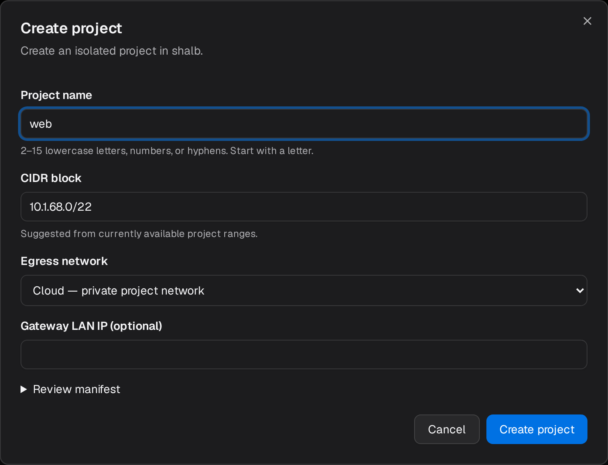
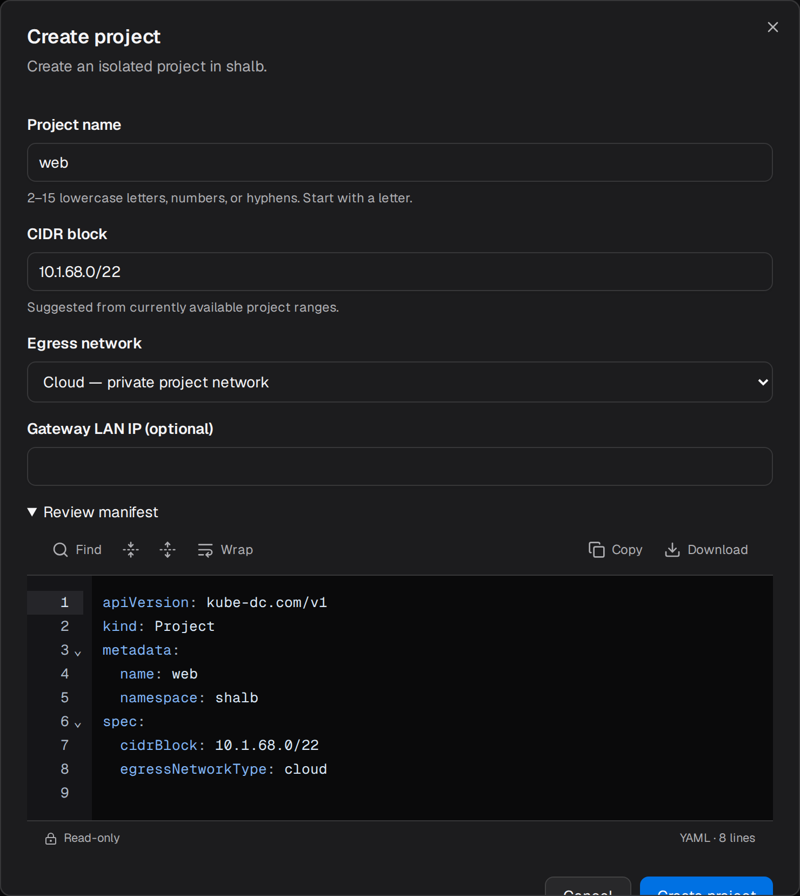
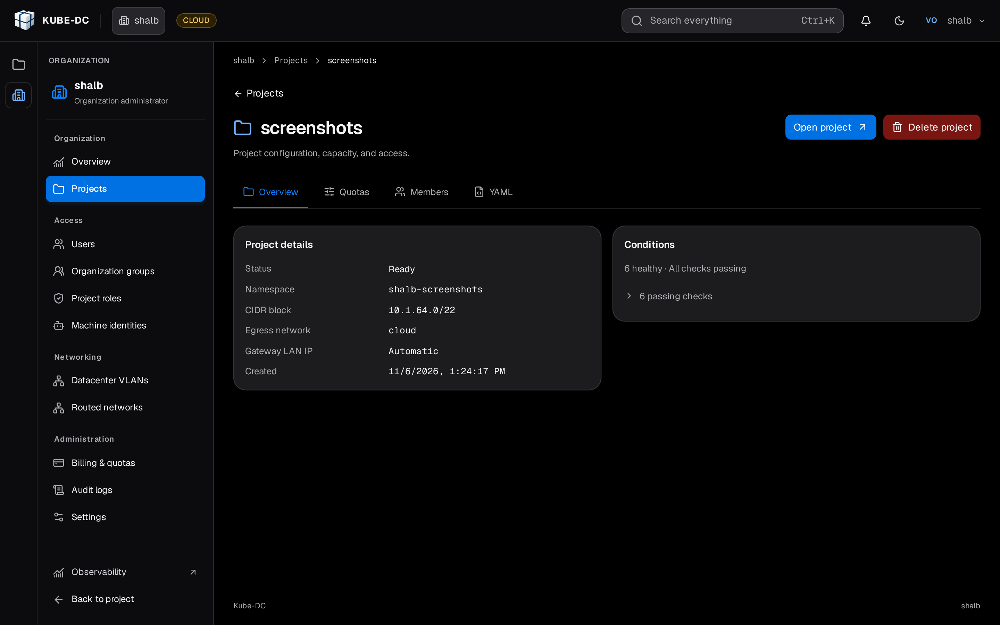
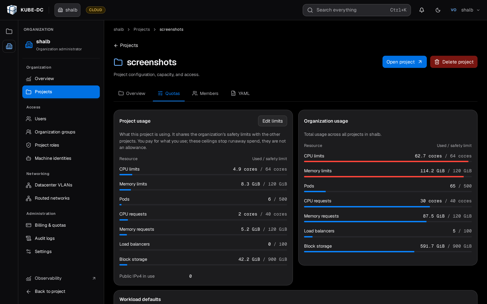

# Create your first Project

A **Project** is the working boundary for applications, virtual machines,
databases, and Managed Clusters. Kube-DC backs each Project with a namespace
named `{organization}-{project}`, Project RBAC, a private network, an optional
quota, and a Project kubeconfig. The namespace is an implementation detail, so
the console and this guide call the environment by its Project name.

## Before you begin

You need:

- A Kube-DC account. See [Sign up and sign in](sign-up-login.md).
- Organization Admin access.
- Familiarity with [Core concepts](core-concepts.md).

## Create a Project

1. Open the account menu in the top right corner.
2. Select **Manage organization**. Organization management opens.
3. In the Organization navigation, click **Projects**.
4. Click **Create project**. The **Create project** dialog opens.

   

5. In **Project name**, enter a name, for example `dev`, `staging`, or
   `production`. Use 2 to 15 lowercase letters, numbers, or hyphens, and start
   with a letter.
6. Optional: change the **CIDR block**. The console suggests a free internal
   IP range for the Project's private network, for example `10.1.68.0/22`.
7. In **Egress network**, select how workloads in this Project reach the
   internet. For help with this field, see
   [Choose a network type](#choose-a-network-type).
8. Optional: in **Gateway LAN IP (optional)**, enter the address of the Project
   NAT gateway inside the CIDR block. If you leave it empty, Kube-DC selects
   the address.
9. Optional: expand **Review manifest** to see the Kubernetes manifest that the
   console applies for this Project.

   

10. Click **Create project**.

The Project appears in the **Projects** list. Its status changes to **Ready**
after Kube-DC creates the Project network and access. To see the Project
configuration, click the Project name.

To start work in the Project, click **Open project**.

:::tip First Project of an Organization
If your Organization has no Projects, the console opens **Create your first
project** after you sign in. Enter a **Project name**, keep the suggested
**Private network**, and click **Create project and start**. This first
Project uses the **Cloud** egress network.
:::

## Choose a network type

The network type selects the address pool for the Project default gateway. Both
types keep workloads on private addresses and use source NAT (SNAT) for
outbound traffic. You cannot change the network type after you create the
Project.

Every provider offers **Cloud**. **Public** appears only when the provider
enables public Project creation. The following table compares the two types:

| Type | Default gateway | Choose it when |
|------|-----------------|----------------|
| Cloud | Cloud-internal address | The normal choice for applications exposed through Gateway Routes or separately allocated EIPs |
| Public | Internet-routable address | The Project needs a public source address at its default gateway |

Neither type exposes a workload by itself. To accept inbound traffic, create a
Gateway Route, a LoadBalancer Service, or a floating IP. Address availability
and cost depend on your provider and your quota. See
[How networking works](networking-overview.md).

## Optional: set a resource quota

By default, a Project shares the full resource pool of your Organization. Set a
quota to stop one Project from consuming all of it.

1. In Organization management, click **Projects**.
2. Click the name of your Project. The Project detail page opens.
3. Click the **Quotas** tab. It shows the Project usage and the Organization
   usage.

   

4. Click **Edit limits**. The **Edit project limits** dialog opens.
5. Set the limits for this Project as Kubernetes quantities:

   - **CPU (cores)**: the maximum number of CPU cores, for example `4`.
   - **Memory**: the maximum RAM, for example `8Gi`.
   - **Storage**: the maximum disk space, for example `100Gi`.
   - **Pods**: the maximum number of pods.

   An empty field uses the Organization pool. If your provider offers
   accelerators, the dialog also shows accelerator limits.

6. Click **Save limits**.

To remove the Project quota, click **Use organization pool** on the **Quotas**
tab, then click **Remove project limits**. The Project then shares the
Organization limits with the other Projects.

## Delete a Project

You need Organization Admin access. Deleting a Project permanently removes its
workloads, storage, networking, and access. Back up any data you want to keep
before you delete it.

1. In Organization management, click **Projects**.
2. Click the name of the Project.
3. Click **Delete project**. The **Delete project** dialog opens.
4. Type the exact Project name to confirm.
5. Click **Delete**.

The console shows **Deleting** until infrastructure cleanup finishes. Quotas
and members are unavailable during deletion. If a Project with the same name
replaced the old one, refresh its details before you confirm again.

For cleanup order and troubleshooting, see
[Project deletion behavior](pathname:///platform/project-resources#deletion-behavior).

## Next steps

- [Deploy your first application](deploy-first-app.md)
- [Create a virtual machine](creating-vm.md)
