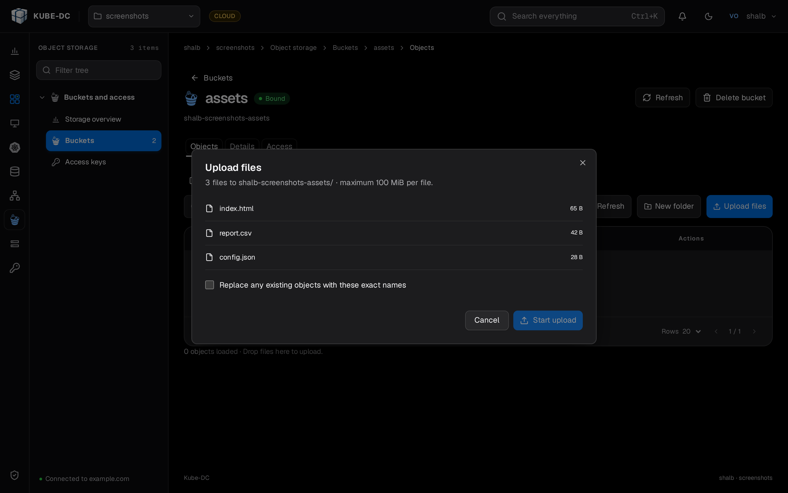

# Object storage (S3)

This page is for a Project member who stores files in Kube-DC object storage. After you read it, you can create buckets, manage their objects and access, and connect S3 tools and workloads to them.

Kube-DC provides S3-compatible object storage for files, images, backups, and other unstructured data. You can manage buckets and objects in the console, or use standard S3 tools such as the AWS CLI, s3cmd, and boto3.

## Buckets

A **bucket** is a container for your objects (files). Each bucket has a unique name, its own access credentials, and a **Private** or **Public read** access policy.

To open object storage, click **Object Storage** in the section rail. The section tree has three pages under **Buckets and access**: **Storage overview**, **Buckets**, and **Access keys**. The **Buckets** page lists your buckets with their name, status, S3 bucket name, storage class, and age.

To open a bucket, click its name. The bucket page has **Refresh** and **Delete bucket** buttons and these tabs:

- **Objects**: the object browser. See [Object browser](#object-browser).
- **Details**: the bucket configuration (claim name, S3 bucket name, storage class, creation date, endpoint, internal host, port, region, and connection Secret) and connection examples.
- **Access**: the **Bucket access policy**, the **Bucket credentials**, and the **Archive key rotations**.

### Create a bucket

#### Use the console

1. In the section rail, click **Object Storage**.
2. Click **Buckets**.
3. Click **Create bucket**. The **Create bucket** dialog opens.
4. In **Bucket name**, enter a name. Use 3–63 lowercase letters, numbers, or hyphens, and start and end with a letter or number. The S3 bucket name (the backing namespace, a hyphen, and this name) can have at most 63 characters. The hint under the field shows the S3 bucket name.
5. Click **Create bucket**. The console opens the bucket's **Details** tab.

A bucket starts private. Its S3 name has the Project's backing namespace as a prefix, so the name stays unique. For example, bucket `one` becomes `acme-production-one`. To make the bucket public after it reaches `Bound`, see [Bucket access: private and public](#bucket-access-private-and-public).

#### Use kubectl

Create an `ObjectBucketClaim` in the Project's backing namespace:

```yaml
apiVersion: objectbucket.io/v1alpha1
kind: ObjectBucketClaim
metadata:
  name: my-bucket
  namespace: acme-production
  labels:
    kube-dc.com/organization: acme
spec:
  bucketName: acme-production-my-bucket
  storageClassName: ceph-bucket
```

The `kube-dc.com/organization` label must identify the owning Organization. The console uses it to count manually created claims in Organization usage and bucket totals.

When the claim is bound, Rook creates a **Secret** and a **ConfigMap** with the bucket's S3 credentials in the same namespace. To read them, run:

```bash
# Check bucket status
kubectl get objectbucketclaim -n acme-production

# Get per-bucket S3 credentials
kubectl get secret my-bucket -n acme-production -o yaml

# Get bucket connection info
kubectl get configmap my-bucket -n acme-production -o yaml
```

The ConfigMap contains these keys:

- `BUCKET_HOST`: Internal S3 endpoint
- `BUCKET_NAME`: Full bucket name in S3
- `BUCKET_PORT`: Service port
- `BUCKET_REGION`: Region identifier

### Bucket access: private and public

A bucket has one of these access policies:

- **Private** (default): only requests with valid S3 credentials can access objects.
- **Public read**: anyone with an object URL can read the object. Writing still requires credentials.

To change the access policy of a bucket:

1. Open the bucket, and click the **Access** tab.
2. Under **Bucket access policy**, click **Change access**. The **Change bucket access** dialog opens.
3. In **Access**, select **Private** or **Public read**.
4. For **Public read**, select **Allow anyone with an object URL to read this bucket's objects**.
5. Click **Apply access policy**.

The **Endpoint** on the bucket's **Details** tab shows the S3 endpoint of your installation. Public object URLs follow this pattern:

```
<s3-endpoint>/<bucket-name>/<object-key>
```

Replace `<s3-endpoint>` with the endpoint, `<bucket-name>` with the S3 bucket name, and `<object-key>` with the object's key.

### Delete a bucket

To delete a bucket in the console:

1. Open the bucket, and click **Delete bucket**.
2. In the confirmation field, type the bucket name.
3. Click **Delete bucket**.

To delete a bucket with kubectl, run:

```bash
kubectl delete objectbucketclaim my-bucket -n acme-production
```

:::warning
Deleting a bucket deletes its claim. The reclaim policy of its storage class controls whether the underlying bucket and its data are deleted. This can permanently remove all objects in the bucket.
:::

## Object browser

The **Objects** tab of a bucket lets you manage objects in the console without external tools. Object browsing is available when the bucket is `Bound`.



The object list shows each object's name, type (**File** or **Folder**), size, and modification time. The toolbar has **Refresh**, **New folder**, and **Upload files**.

To upload files:

1. Open the bucket. The **Objects** tab opens.
2. Click **Upload files**.
3. Select one or more files. The **Upload files** dialog lists the files. Each file can be up to 100 MiB.
4. Optional: select **Replace any existing objects with these exact names** to overwrite objects that have the same names.
5. Click **Start upload**. The dialog shows the progress of each file.

You can also drop files on the object list to open the **Upload files** dialog.

To create a folder:

1. Click **New folder**. The **New folder** dialog opens.
2. In **Folder name**, enter the name.
3. Click **Create folder**.

The **Actions** menu of an object offers these actions:

- **Download**: downloads the file.
- **Move / rename**: moves the object to another key in the bucket.
- **Copy public URL**: copies a direct link. This action appears only for public buckets.
- **Delete**: deletes the object. For a folder, the action is **Delete folder and contents**.

To act on several objects, select them in the list, and click **Download selected files** or **Delete selected**.

## Access keys

Kube-DC exposes two credential scopes:

### Organization account keys

The **Access keys** page manages credentials for the Organization's RGW account. These keys can operate buckets that the account owns. The platform also uses them for account administration and usage reporting.

Buckets that you create in the console or as standard ObjectBucketClaims are owned by separate, per-bucket users. Organization account keys do **not** grant data access to every ObjectBucketClaim in the Organization.

The **Access keys** page offers these controls:

- **Reveal primary credentials**: shows the primary access key ID and secret key under **Organization credentials**.
- **Generate access key**: creates another key for the Organization account. Save its secret before you close the result, because you cannot retrieve it again.
- **Revoke**: revokes a key after you type its access key ID. The primary key is protected.

Use Organization account keys only with buckets that the account owns. For buckets created in the console and for ObjectBucketClaims, use the per-bucket credentials. The **S3 connection** panel on the **Storage overview** page shows the endpoint and region.

### Per-bucket keys

Each bucket created in the console or as an ObjectBucketClaim has its own credentials. To see them in the console, open the bucket's **Access** tab and click **Reveal bucket credentials**. They are also in a Kubernetes Secret in the bucket's backing namespace. To read them with kubectl, run:

```bash
# Get per-bucket credentials
kubectl get secret my-bucket -n acme-production -o jsonpath='{.data.AWS_ACCESS_KEY_ID}' | base64 -d
kubectl get secret my-bucket -n acme-production -o jsonpath='{.data.AWS_SECRET_ACCESS_KEY}' | base64 -d
```

Per-bucket keys are scoped to that specific bucket only.

### Rotate a per-bucket key

Where your platform operator has enabled key rotation, a Project admin can replace a bucket's
key while managed services keep using the bucket as their backup archive. A rotation creates a
second key and writes it into the bucket's Secret. It then waits until every managed service that
reads or writes the bucket has switched to the second key or no longer exists. Only then does it
revoke the old key.

The console lists a bucket's rotations under **Archive key rotations** on the bucket's
**Access** tab. It shows each rotation's phase and start time, and offers **Abandon rotation**
for a rotation that has not finished. The abandon dialog asks for a **Reason**. Only Project
admins can manage rotations there. To start a rotation, use the API with your console session
token:

```text
POST https://backend.<domain>/api/object-storage/<project-namespace>/buckets/<bucket>/key-rotations
{"idempotencyKey": "rotate-2026-10", "claimUID": "<ObjectBucketClaim UID>",
 "sourceSecretUID": "<bucket Secret UID>", "gracePeriodSeconds": 300}
```

Replace `<domain>`, `<project-namespace>`, and `<bucket>` with your values. The two UIDs pin the bucket and its Secret as you saw them. The platform refuses a request for a changed incarnation.
Repeat the same request safely: the idempotency key names one rotation. `GET` on the same path
lists rotations, and `GET .../key-rotations/<rotation>` shows one, including its phase and why it
waits.

A rotation that can never finish (for example, a service that cannot switch keys) can be
**abandoned**: `POST .../key-rotations/<rotation>/abandon` with
`{"rotationUID": "<uid>", "reason": "<why>"}`. If revocation has not started, abandoning revokes nothing. Both the old and the
second key stay valid, the rotation ends as `Abandoned`, and the next rotation of the bucket that
succeeds retires the keys this one left behind. An abandon cannot be withdrawn. While a key is
being revoked, an abandon waits until that step finishes.

## Use S3 tools

The examples in this section use a bucket's per-bucket credentials. Set `S3_ENDPOINT` to the **Endpoint** value on the bucket's **Details** tab or on the **Storage overview** page.

### AWS CLI

```bash
export S3_ENDPOINT='https://s3.your-provider.example'

# Configure credentials
aws configure set aws_access_key_id '<access-key-id>'
aws configure set aws_secret_access_key '<secret-access-key>'

# Upload a file
aws --endpoint-url "$S3_ENDPOINT" s3 cp myfile.txt s3://acme-production-my-bucket/

# Download a file
aws --endpoint-url "$S3_ENDPOINT" s3 cp s3://acme-production-my-bucket/myfile.txt ./

# List objects in a bucket
aws --endpoint-url "$S3_ENDPOINT" s3 ls s3://acme-production-my-bucket/

# Sync a directory
aws --endpoint-url "$S3_ENDPOINT" s3 sync ./backups s3://acme-production-my-bucket/backups/
```

Replace `<access-key-id>` and `<secret-access-key>` with the bucket's credentials.

### Python (boto3)

```python
import os
import boto3

s3 = boto3.client(
    's3',
    endpoint_url=os.environ['S3_ENDPOINT'],
    aws_access_key_id='<access-key-id>',
    aws_secret_access_key='<secret-access-key>',
)

# List objects in the bucket available to these credentials
response = s3.list_objects_v2(Bucket='acme-production-my-bucket')
for item in response.get('Contents', []):
    print(item['Key'])

# Upload a file
s3.upload_file('myfile.txt', 'acme-production-my-bucket', 'myfile.txt')

# Download a file
s3.download_file('acme-production-my-bucket', 'myfile.txt', 'downloaded.txt')
```

### s3cmd

```bash
export S3_HOST='s3.your-provider.example'

# Configure
s3cmd --configure \
  --host="$S3_HOST" \
  --host-bucket="$S3_HOST" \
  --access_key='<access-key-id>' \
  --secret_key='<secret-access-key>'

# List objects
s3cmd ls s3://acme-production-my-bucket/

# Upload
s3cmd put myfile.txt s3://acme-production-my-bucket/
```

### Use credentials from Kubernetes Secrets

For workloads running inside your project, you can mount the per-bucket credentials directly:

```yaml
apiVersion: v1
kind: Pod
metadata:
  name: s3-worker
  namespace: acme-production
spec:
  restartPolicy: Never
  containers:
    - name: worker
      image: amazon/aws-cli
      command: ["/bin/sh", "-c"]
      args:
        - >-
          aws --endpoint-url "http://${BUCKET_HOST}:${BUCKET_PORT}"
          s3 ls "s3://${BUCKET_NAME}/"
      env:
        - name: AWS_ACCESS_KEY_ID
          valueFrom:
            secretKeyRef:
              name: my-bucket
              key: AWS_ACCESS_KEY_ID
        - name: AWS_SECRET_ACCESS_KEY
          valueFrom:
            secretKeyRef:
              name: my-bucket
              key: AWS_SECRET_ACCESS_KEY
        - name: BUCKET_HOST
          valueFrom:
            configMapKeyRef:
              name: my-bucket
              key: BUCKET_HOST
        - name: BUCKET_PORT
          valueFrom:
            configMapKeyRef:
              name: my-bucket
              key: BUCKET_PORT
        - name: AWS_DEFAULT_REGION
          valueFrom:
            configMapKeyRef:
              name: my-bucket
              key: BUCKET_REGION
        - name: BUCKET_NAME
          valueFrom:
            configMapKeyRef:
              name: my-bucket
              key: BUCKET_NAME
```

## Quotas

Object storage limits depend on your provider, your Organization allocation, and your plan. The **Storage overview** page shows the Organization's storage use, buckets, and objects against the configured limits. Do not rely on fixed plan values in automation.

The **Storage overview** page aggregates usage for ObjectBucketClaims that carry the correct `kube-dc.com/organization` label.

The standard Rook ObjectBucketClaim provisioner creates a separate S3 user for each bucket. The Organization account quota displayed by Kube-DC is therefore not, by itself, an aggregate admission boundary for those per-bucket users. Do not assume that crossing the displayed limit rejects a claim or an upload. Your provider can apply additional enforcement.

## Quick reference

| Action | Command |
|--------|---------|
| List buckets | `kubectl get objectbucketclaims -n acme-production` |
| Create bucket | `kubectl apply -f bucket.yaml` |
| Delete bucket | `kubectl delete objectbucketclaim <name> -n acme-production` |
| Get bucket credentials | `kubectl get secret <bucket-name> -n acme-production` |
| Get bucket config | `kubectl get configmap <bucket-name> -n acme-production` |
| S3 list objects (AWS CLI) | `aws --endpoint-url "$S3_ENDPOINT" s3 ls s3://bucket/` |
| S3 upload | `aws --endpoint-url "$S3_ENDPOINT" s3 cp file s3://bucket/` |

## Next steps

- [Block storage](block-storage.md): Persistent volumes for VMs and containers
- [Backups and snapshots](backups-snapshots.md)
