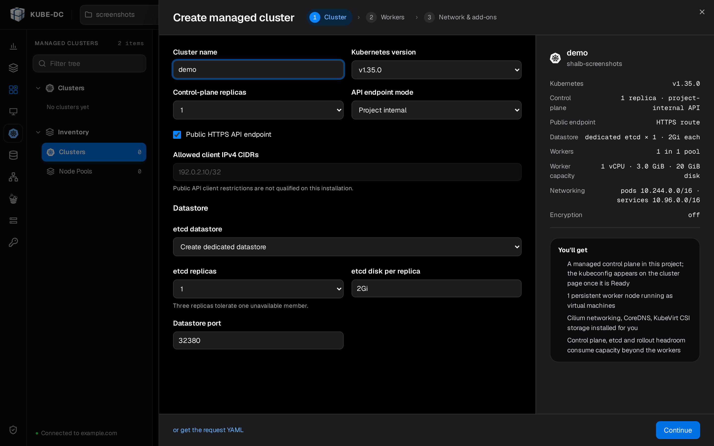
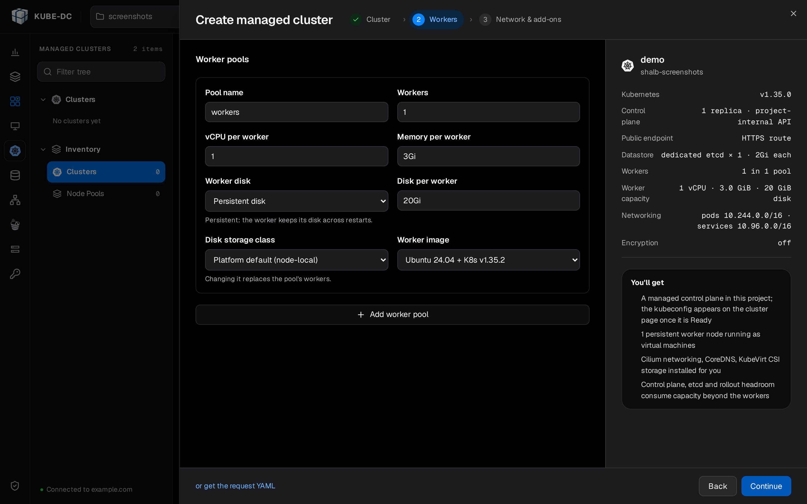
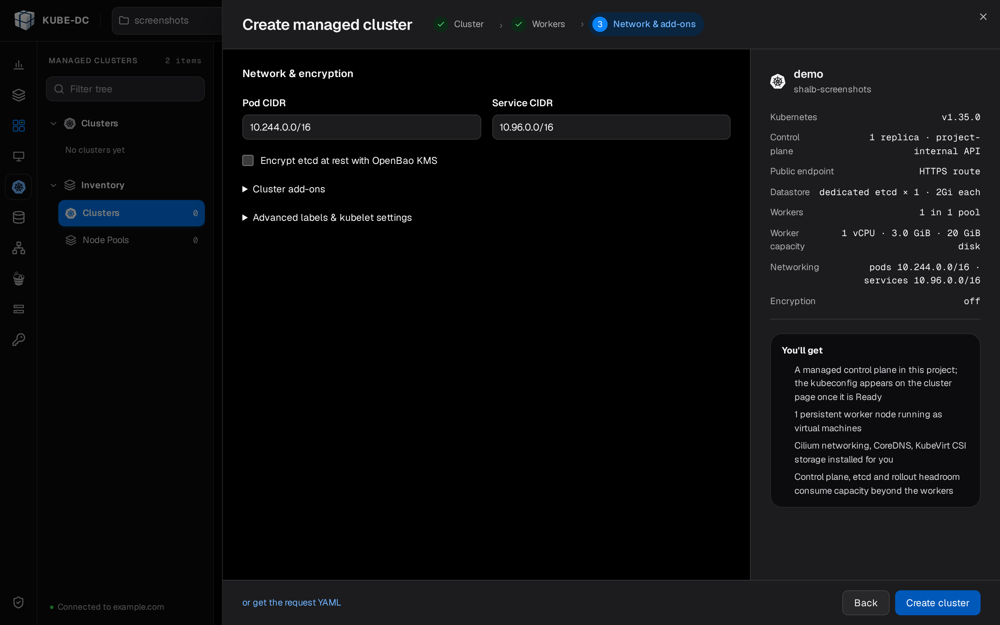
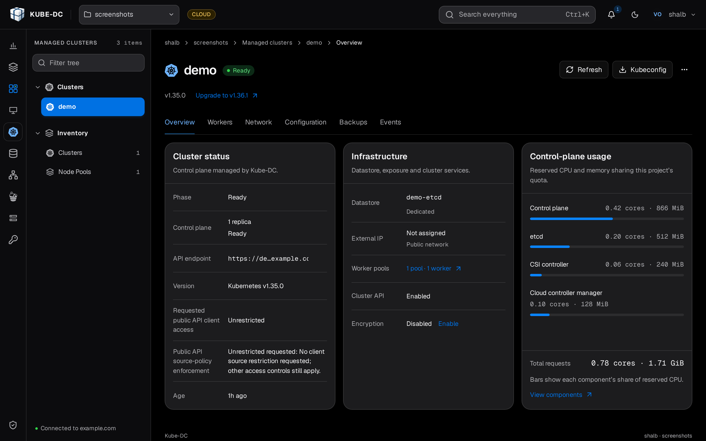

import {ManagedClusterTopologyDiagram} from '@site/src/components/Diagram/CloudTopologyDiagrams';

# Provision a Managed Cluster

A **Managed Cluster** is a Kubernetes cluster with its own API, control plane, worker nodes, and networking. Kube-DC keeps its infrastructure resources in the owning Project's backing namespace (`{organization}-{project}`), while you administer cluster workloads through a separate Managed Cluster kubeconfig.

## How it works

When you create a Managed Cluster, Kube-DC orchestrates several components:

- **Control Plane**: Managed by [Kamaji](https://kamaji.clastix.io/). The API server, scheduler, and controller manager run as pods in your Project's backing namespace. The control plane needs no VMs.
- **Worker Nodes**: Provisioned through [Cluster API](https://cluster-api.sigs.k8s.io/). KubeVirt-backed workers run as VMs on the management cluster; provider catalogs can also offer CloudSigma-backed workers.
- **etcd DataStore**: A dedicated or shared etcd cluster stores your Kubernetes state, managed automatically with TLS certificates and persistent storage.
- **Cloud Controller Manager (CCM)**: Bridges your Managed Cluster with the infrastructure, enabling LoadBalancer services and node lifecycle management.
- **Cluster add-ons**: Cilium CNI, CoreDNS, and a provider-compatible CSI driver are deployed automatically through [Sveltos](https://projectsveltos.github.io/sveltos/).

The following diagram shows a KubeVirt-backed example for Project `production`, whose backing namespace is `acme-production`.

<details data-github-only>
<summary>Diagram source for GitHub</summary>

```
┌───────────────────── Management cluster ───────────────────────────┐
│                                                                    │
│  ┌────────────── Project infrastructure: acme-production ────────┐ │
│  │                                                               │ │
│  │  KdcCluster "dev"                                             │ │
│  │    ├── Service: dev-cp (LoadBalancer → API server)            │ │
│  │    ├── TenantControlPlane: dev-cp (Kamaji)                    │ │
│  │    │     └── Pods: api-server, scheduler, controller-manager  │ │
│  │    ├── KdcClusterDatastore: dev-etcd                          │ │
│  │    │     └── StatefulSet: dev-etcd-etcd (etcd cluster)        │ │
│  │    ├── MachineDeployment: dev-workers                         │ │
│  │    │     └── VMs: dev-workers-xxxxx (KubeVirt)                │ │
│  │    └── CCM Deployment: kccm-dev                               │ │
│  │                                                               │ │
│  └───────────────────────────────────────────────────────────────┘ │
└────────────────────────────────────────────────────────────────────┘
                              │
                              ▼
┌────────────────── Managed Cluster "dev" ──────────────────────────┐
│  Nodes: worker-1, worker-2, worker-3                              │
│  Your workloads: Deployments, Services, PVCs                      │
└───────────────────────────────────────────────────────────────────┘
```

</details>

<ManagedClusterTopologyDiagram />

## Before you begin

- A Kube-DC [Project](first-project.md) with sufficient resource quota
- For kubectl access: [kubeconfig configured](cli-kubeconfig.md) for the platform Project

## Managed clusters page

To list the Managed Clusters in your Project, select **Managed clusters** in the section rail.

The page shows the **Clusters**, **Ready**, **Worker pools**, and **Ready workers** totals. The table lists each cluster with its **Name**, **Version**, **Status**, **Control plane**, **Workers**, **Pools**, and **Age**. The actions menu of a row has these items:

- **View cluster**: opens the cluster detail page.
- **Upgrade Kubernetes**: opens the upgrade dialog. See [Upgrade the Kubernetes version](cluster-management.md#upgrade-the-kubernetes-version).
- **Edit labels**: edits the labels of the `KdcCluster`.
- **Delete cluster**: opens the **Delete managed cluster** dialog.

## Create a Managed Cluster in the console

The **Create managed cluster** sheet has three steps: **Cluster**, **Workers**, and **Network & add-ons**. A summary panel next to the form shows the values that you selected. To see the request as YAML instead, click **or get the request YAML** at the bottom of the sheet.

To create a Managed Cluster:

1. In the section rail, select **Managed clusters**.
2. Click **Create cluster**. The **Create managed cluster** sheet opens on the **Cluster** step.
3. Fill in the **Cluster** step. See [Step 1: Cluster](#step-1-cluster).
4. Click **Continue**. The sheet moves to the **Workers** step.
5. Fill in the **Workers** step. See [Step 2: Workers](#step-2-workers).
6. Click **Continue**. The sheet moves to the **Network & add-ons** step.
7. Fill in the **Network & add-ons** step. See [Step 3: Network and add-ons](#step-3-network-and-add-ons).
8. Click **Create cluster**. The console opens the detail page of the cluster.

To return to an earlier step, click **Back**.

### Step 1: Cluster



The **Cluster** step has these fields:

- **Cluster name**: a name that is unique in your Project. Use up to 32 lowercase letters, digits, and hyphens.
- **Kubernetes version**: a version from the platform catalog, for example `v1.35.0`.
- **Control-plane replicas**: `1`, `2`, or `3` API server replicas. Use `1` for development and `3` for production.
- **API endpoint mode**: **Project internal** or **Cloud network**. **Project internal** appears only when your installation enables it.
- **Public HTTPS API endpoint**: publishes the Kubernetes API through an HTTPS route on the shared gateway. Keep it selected to use the kubeconfig from a workstation.
- **Allowed client IPv4 CIDRs**: appears only for **Project internal**. It restricts the public API clients. The field is read-only when your installation does not qualify this restriction. See [Restrict public Kubernetes API clients](cluster-management.md#restrict-public-kubernetes-api-clients).

The **Datastore** section sets where the cluster stores its etcd state:

- **etcd datastore**: select **Create dedicated datastore**, or select an existing datastore in your Project. A dedicated datastore belongs to this cluster only. Use a shared datastore for development, and a dedicated datastore for production. With **Project internal**, the list shows only internal datastores.
- **etcd replicas**: `1`, `3`, or `5`. Three replicas tolerate one unavailable member. Use `1` for development and `3` for production.
- **etcd disk per replica**: the volume size of each etcd member, for example `2Gi`.
- **Datastore port**: the service port of the dedicated datastore. The console suggests a free port. The cluster reaches etcd members over DNS on port `2379`.

The etcd fields appear only for **Create dedicated datastore**.

### Step 2: Workers



The **Workers** step defines one or more worker pools. All workers in a pool have the same configuration. Each pool has these fields:

- **Pool name**: an identifier that is unique in the cluster, for example `workers`.
- **Workers**: the number of worker VMs.
- **vCPU per worker** and **Memory per worker**: the resources of each worker, for example `1` and `3Gi`.
- **Worker disk**: **Persistent disk** keeps the disk of a worker across restarts. **Ephemeral (container disk)** rebuilds the disk from the image when the worker is replaced.
- **Disk per worker**: the root disk size of a persistent worker, for example `20Gi`.
- **Disk storage class**: the storage class of a persistent worker disk. **Platform default (node-local)** uses the platform default. A change to this field replaces the workers of the pool.
- **Worker image**: the OS image of the workers. The list shows only the images that match the selected Kubernetes version, for example `Ubuntu 24.04 + K8s v1.35.2`.

To add a pool with a different configuration, click **Add worker pool**. To remove an extra pool, click **Remove pool** `<pool-name>` under that pool.

### Step 3: Network and add-ons



The **Network & add-ons** step has these fields:

- **Pod CIDR**: the IP range for Pods. The default is `10.244.0.0/16`.
- **Service CIDR**: the IP range for Kubernetes Services. The default is `10.96.0.0/16`. Each cluster has isolated networking.
- **Encrypt etcd at rest with OpenBao KMS**: encrypts supported API resources with a KMS key. See [Encryption at rest](#encryption-at-rest).

When you select **Encrypt etcd at rest with OpenBao KMS**, these fields appear:

- **KMS key reference**: the name of a `KMSKey` in your Project. Leave it empty to use a platform-managed key.
- **Rotate encryption key automatically**: rotates the key on a schedule that you set in **Rotation interval**, for example `720h`.
- **Backup KMS key reference**: an optional, separate key for backup encryption.

Expand **Cluster add-ons** to choose the add-ons that the platform installs. All three are selected by default:

| Add-on | Description |
|-------|-------------|
| **Cilium networking** | Pod networking and network policy. Keep it selected for a ready-to-use cluster. |
| **CoreDNS** | Cluster DNS (`cluster.local`). Keep it selected for a ready-to-use cluster. |
| **KubeVirt CSI storage** | Persistent volumes backed by hotplug DataVolumes. Keep it selected for stateful workloads. |

Optional: expand **Advanced labels & kubelet settings** to edit the cluster labels and kubelet settings as YAML.

## Create a Managed Cluster with kubectl

Apply a `KdcCluster` resource to your Project's backing namespace:

```yaml
apiVersion: k8s.kube-dc.com/v1alpha1
kind: KdcCluster
metadata:
  name: dev
  namespace: acme-production
  annotations:
    k8s.kube-dc.com/expose-route: "true"
spec:
  version: v1.36.1
  controlPlane:
    replicas: 1
  dataStore:
    dedicated: true
    eipName: default-gw
    port: 32381
  network:
    serviceCIDR: 10.96.0.0/16
    podCIDR: 10.244.0.0/16
  eip:
    create: true
    externalNetworkType: cloud
  enableClusterAPI: true
  workers:
    - name: workers
      replicas: 3
      cpuCores: 2
      memory: 8Gi
      diskSize: 30Gi
      image: docker.io/shalb/ubuntu-2404-container-disk:v1.36.1
      architecture: amd64
      infrastructureProvider: kubevirt
      storageType: datavolume
```

```bash
kubectl apply -f cluster.yaml
```

### Spec reference

| Field | Description | Default |
|-------|-------------|---------|
| `spec.version` | Kubernetes version | Required |
| `spec.controlPlane.replicas` | API server replicas (1–5) | `2` |
| `spec.dataStore.dedicated` | Create dedicated etcd | `false` |
| `spec.dataStore.eipName` | EIP for datastore LoadBalancer | `default-gw` |
| `spec.dataStore.port` | Optional dedicated datastore service port; it must be unique on the selected EIP. The console allocates `32380`–`32499`; the API defaults to `2379` when omitted. | `2379` |
| `spec.network.serviceCIDR` | Kubernetes service CIDR | `10.96.0.0/12` |
| `spec.network.podCIDR` | Pod network CIDR | `10.244.0.0/16` |
| `spec.eip.create` | Auto-create EIP for API server | `true` |
| `spec.eip.externalNetworkType` | `cloud` or `public` | `public` |
| `spec.enableClusterAPI` | Enable Cluster API worker management | `false` |
| `spec.workers[].name` | Worker pool name (unique) | Required |
| `spec.workers[].replicas` | Number of workers in pool | `2` |
| `spec.workers[].cpuCores` | CPU cores per worker | `1` |
| `spec.workers[].memory` | Memory per worker | `2Gi` |
| `spec.workers[].image` | KubeVirt worker image; choose one compatible with `spec.version` | Platform default |
| `spec.workers[].storageType` | `datavolume` (persistent) or `containerdisk` (ephemeral) | `datavolume` |
| `spec.workers[].infrastructureProvider` | `kubevirt` or `cloudsigma` | `kubevirt` |
| `spec.loadBalancer.blocks` | Number of `/28` blocks (16 VIPs each) for [project-internal LoadBalancer VIPs](cluster-management.md#project-internal-vips-private-loadbalancer) (1–8; KubeVirt clusters, where the platform enables VIP pools) | `1` |
| `spec.encryption.etcd.enabled` | Encrypt selected API data at rest in the cluster's etcd (Secrets by default) (KMS v2 envelope through OpenBao Transit). See [Encryption at rest](#encryption-at-rest) | `false` |
| `spec.encryption.etcd.kekRotation.enabled` | Auto-rotate the Key Encryption Key on a schedule | `false` |
| `spec.encryption.etcd.kekRotation.interval` | Duration between rotations. The units are `d`, `h`, `m`, and `s`; `w` is not accepted. Must be at least 7d, and at least `spec.backup.retentionDays`. | None |

### Annotations

| Annotation | Description |
|------------|-------------|
| `k8s.kube-dc.com/expose-route: "true"` | Expose API endpoint externally through TLSRoute (recommended for cloud network type) |
| `kube-dc.com/restore-from` | Selects a snapshot for a disruptive restore of an existing Managed Cluster. Adding it starts the restore workflow; it is not a first-boot option. Plaintext `.db` keys and envelope directories are detected automatically. In the console, use **Restore** on a snapshot row in the cluster's **Backups** tab. Read [Backups and Recovery](backups-snapshots.md) before you restore. |

## Encryption at rest

Your cluster's `etcd` stores everything `kubectl` returns, including Secrets,
ConfigMaps, CRDs, ServiceAccount tokens. By default these are written
to disk in plaintext. Flipping a single field encrypts them with
**KMS v2 envelope encryption**: each row gets a fresh AES-256-GCM data
key (DEK), and the DEK is wrapped by a per-cluster Key Encryption Key
(KEK) that lives in Kube-DC's OpenBao Transit engine and never leaves
in plaintext.

```yaml
spec:
  encryption:
    etcd:
      enabled: true
```

That setting enables the default encryption flow: a
per-cluster `KMSKey` is auto-created, the apiserver starts with a KMS
plugin sidecar, and every new Secret you create from that point on is
stored encrypted. **Existing Secrets are re-encrypted on their next update.** Do not use a delete-and-recreate sweep: it can rotate generated metadata, interrupt controllers, and remove resources between operations. Plan a controlled maintenance workflow with your platform operator when existing data must be rewritten immediately.

To check it took effect:

```bash
kubectl get kdccluster <name> -o jsonpath='{.status.encryption}'
```

You should see a `resolvedKeyRef` (the name of the auto-created KMSKey)
and `kekRotation.currentVersion: 1`.

### Rotate the KEK

Encryption at rest by itself does not rotate the wrapping key.
To rotate it, set a schedule:

```yaml
spec:
  encryption:
    etcd:
      enabled: true
      kekRotation:
        enabled: true
        interval: 90d
```

Rules:

- Units are `d`, `h`, `m`, `s` (no `w`).
- Minimum 7 days, maximum 730 days.
- Interval must be ≥ `spec.backup.retentionDays * 24h`. The rationale:
  rotating faster than backups age out leaves historic backups bound
  to key versions you'd have to manage by hand.

Rotation creates a new Transit key version. Old key versions stay
alive, and historic Secrets and backups stay decryptable indefinitely.
The platform does not re-wrap existing rows in bulk. Each row re-wraps
on its next update.

Status:

```bash
kubectl get kdccluster <name> -o jsonpath='{.status.encryption.kekRotation}'
# {"currentVersion":2,"enabled":true,"lastRotatedTime":"...","minDecryptionVersion":1,"nextRotationTime":"..."}
```

### Backups stay encrypted too

When `encryption.etcd.enabled: true`, `spec.backup.enabled: true`, and the
platform's managed backup bucket is available, the per-cluster snapshot CronJob
writes envelope-encrypted snapshots to S3 as three sibling objects. Enabling the
field alone does not provision object storage; confirm the Managed Cluster's
backup status on each installation.

See [Backups and snapshots](backups-snapshots.md). Restoring an encrypted snapshot
also requires OpenBao access, so possession of the S3 objects is not sufficient
to decrypt them.

### Limits

- **What's encrypted:** `Secret` values by default. Opt into
  `ConfigMap` too through `spec.encryption.etcd.resources: ["secrets",
  "configmaps"]`. Other resources (`leases`, `events`, `endpoints`,
  `pods`) stay plaintext for the high-write-rate / low-sensitivity
  reasons. See the design document on the public site.
- **What's NOT encrypted:** application data on PVCs. Use a workload-
  side mechanism (LUKS-backed StorageClass, application encryption,
  Velero with restic) for that.
- **Disabling:** flipping `enabled: false` on a cluster that was
  previously encrypted is blocked by design, because the apiserver would
  fail to read existing rows. Contact your cluster admin for the
  documented two-step migration.

## Monitor Managed Cluster creation

```bash
# Watch cluster status
kubectl get kdccluster -n acme-production -w

# Example output:
# NAME   VERSION   PHASE   ENDPOINT                                        DATASTORE   AGE
# dev    v1.35.0   Ready   https://dev-cp-acme-production.example.com:443     dev-etcd    5m

# Check datastore status
kubectl get kdcclusterdatastores -n acme-production

# Example output:
# NAME       READY   DEDICATED   DATASTORE   AGE
# dev-etcd   Ready   true        dev-etcd    5m
```

Provisioning time depends on worker capacity, image availability, and networking. The cluster moves through these phases: `Pending` → `WaitingForService` → `Provisioning` → `Ready`.

## Access the Managed Cluster

### In the console

The cluster detail page opens when you click a cluster name on the **Managed clusters** page.



The header shows the phase of the cluster, its Kubernetes version, and an **Upgrade to vX.Y.Z** link when an upgrade is available. The page has the **Overview**, **Workers**, **Network**, **Configuration**, **Backups**, and **Events** tabs. The **Overview** tab has three cards:

- **Cluster status**: the **Phase**, **Control plane** replicas and readiness, **API endpoint**, **Version**, and **Age**.
- **Infrastructure**: the **Datastore**, **External IP**, **Worker pools**, **Cluster API**, and **Encryption** state.
- **Control-plane usage**: the CPU and memory that the control plane, etcd, and cluster services reserve from your Project quota.

To download the kubeconfig after the cluster is `Ready`:

1. On the cluster detail page, click **Kubeconfig**. The **Cluster kubeconfig** dialog opens.
2. Click **Download**. The browser saves the file `<cluster>-kubeconfig.yaml`.

`<cluster>` is the name of the Managed Cluster. The dialog closes when you switch to another browser tab. The kubeconfig grants cluster administrator access, so store it securely.

### With kubectl

For a cluster with a public API endpoint, the following Project-level command reads the same external kubeconfig that **Kubeconfig** returns:

```bash
kubectl get secret dev-cp-admin-kubeconfig-external -n acme-production \
  -o jsonpath='{.data.admin\.conf}' | base64 -d > /tmp/dev-kubeconfig

kubectl --kubeconfig=/tmp/dev-kubeconfig get nodes
```

If the external Secret does not exist, the cluster API is private. Its internal kubeconfig is intended for clients with connectivity to the platform network; enable the external API endpoint or use an approved private access path before downloading it to a workstation.

## Managed Cluster infrastructure

When you create a Managed Cluster, its `KdcCluster` and related infrastructure resources are provisioned automatically in the Project's backing namespace:

| Resource | Name Pattern | Purpose |
|----------|-------------|---------|
| `Service` (LoadBalancer) | `{cluster}-cp` | API server endpoint |
| `Service` (ClusterIP) | `{cluster}-cp-ext` | External DNS endpoint |
| `TenantControlPlane` | `{cluster}-cp` | Kamaji control plane pods |
| `KdcClusterDatastore` | `{cluster}-etcd` | etcd (if dedicated) |
| `StatefulSet` | `{cluster}-etcd-etcd` | etcd pods |
| `Service` (LoadBalancer) | `{cluster}-etcd-etcd-lb` | etcd external access |
| `Cluster` (CAPI) | `{cluster}` | Cluster API cluster object |
| `MachineDeployment` | `{cluster}-{pool}` | Worker pool VMs |
| `Deployment` | `kccm-{cluster}` or `csccm-{cluster}` | Provider Cloud Controller Manager |

The following example shows the Services created for cluster `dev` in the `acme-production` backing namespace:

```
$ kubectl get svc -n acme-production | grep dev
dev-cp                  LoadBalancer   10.101.79.219    100.65.0.148   6443/TCP    18d
dev-cp-ext              ClusterIP      None             <none>         6443/TCP    18d
dev-etcd-etcd           ClusterIP      None             <none>         2379/TCP    18d
dev-etcd-etcd-lb        LoadBalancer   10.101.20.207    100.65.0.115   32382/TCP   18d
dev-etcd-etcd-lb-ext    ClusterIP      None             <none>         32382/TCP   18d
```

## Next steps

- [Cluster management](cluster-management.md): Exposing services, persistent storage, scaling, and operations
- [CLI and kubeconfig access](cli-kubeconfig.md)
