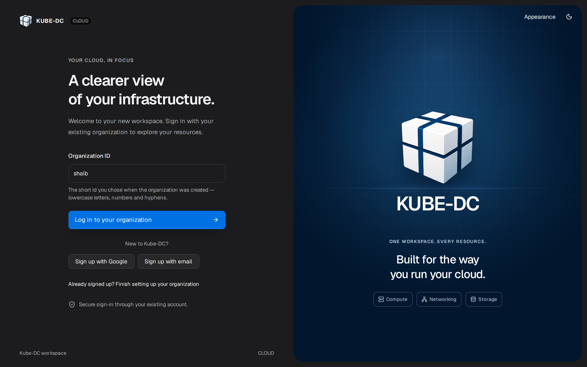
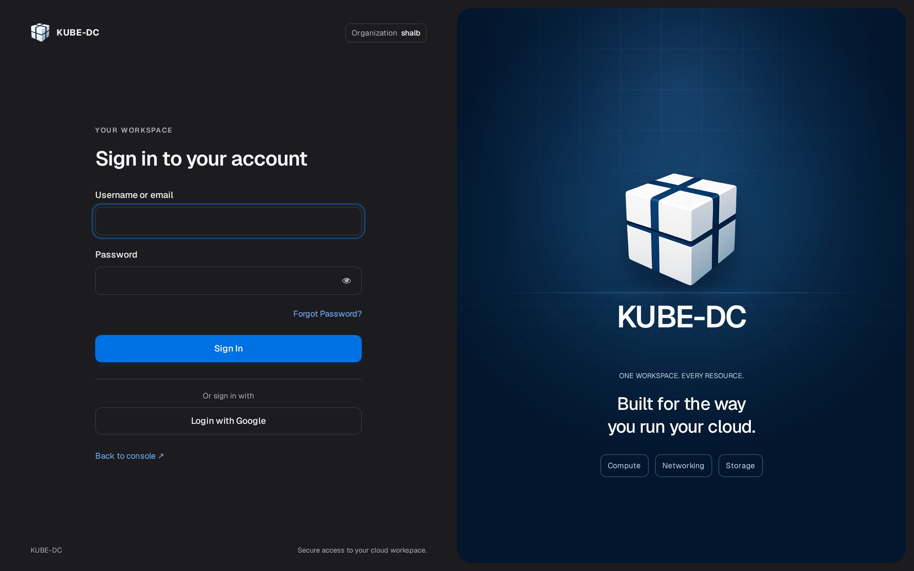

# Sign up and sign in

To use Kube-DC, you need a verified user account and membership of an
Organization. This guide covers account creation, Organization setup, and the
sign-in options.

## Before you begin

You need:

- A valid email address
- A current web browser: Chrome, Firefox, Safari, or Edge

## Create your account

1. Go to `<console-url>`, the console address your provider gives you. The
   console start page opens.
2. Click **Sign up with email** or **Sign up with Google**.
3. Fill in the registration form:

   - **Email**: your email address. Kube-DC uses it for sign-in and
     notifications.
   - **First name**: your first name.
   - **Last name**: your last name.

4. Click **Register**.
5. Open the verification email and confirm your account.

:::note Sign-up options depend on your provider
The sign-up buttons appear only when your provider enables self sign-up. The
**Sign up with Google** button appears only when your provider enables Google
sign-in. If you see no sign-up buttons, ask your provider for an account.
:::

:::tip Google single sign-on
If you sign up with Google, Kube-DC verifies your account automatically. Go
straight to Organization setup.
:::

If you verified your email but did not finish Organization setup, open the
console start page and click **Already signed up? Finish setting up your
organization**.

## Set up your Organization

After registration, the console shows **Set up your workspace**. There you
create an Organization or ask to join one. An Organization is the identity,
membership, billing, and shared-quota boundary for its Projects.

### Create an Organization

Follow these steps if you start fresh, or if you need a separate Organization:

1. Click **Create organization**.
2. Enter a unique **Organization ID**. It is a short id, not a full name. It
   appears in web addresses and you cannot change it later. Use lowercase
   letters, numbers, and hyphens.
3. Set your **Organization login password**. It needs at least 8 characters.
4. Enter the password again in **Confirm password**.
5. Click **Create workspace**.

If the Organization ID is taken, the console shows that it already exists. Pick
another ID, or click **Ask to join instead**.

After the Organization is ready, the console can ask for two more things:

- **Choose how this organization pays**: appears when your provider sells
  plans. Select a plan to continue.
- **Create your first project**: appears when the Organization has no Projects.
  See [Create your first Project](first-project.md).

:::note Organization Admin
The user who creates an Organization becomes its Organization Admin, with full
access to users, Projects, and settings. Keep your Organization login password
secure. It belongs to your own user account. Organization members do not share
it.
:::

### Join an existing Organization

Follow these steps if your team already has an Organization:

1. Click **Join organization**.
2. Enter the existing **Organization ID**.
3. Click **Request access**. The console shows **Request sent**.
4. Wait for an Organization Admin to approve the request.

An Organization Admin must approve every join request. Kube-DC sends you an
email when the request is processed.

## Sign in

1. Go to `<console-url>`, the console address your provider gives you.
2. Enter your **Organization ID**.
3. Click **Log in to your organization**. The **Sign in to your account** page
   opens.
4. Enter your **Username or email** and your Organization login password in
   **Password**.
5. Click **Sign In**.

If your Organization has Google sign-in configured, you can click **Login with
Google** instead of steps 4 and 5.

:::tip Bookmark your Organization
For faster access, bookmark a sign-in URL that fills in your Organization ID:
`<console-url>/?realm=<organization>`. Replace `<console-url>` with your
console address and `<organization>` with your Organization ID.
:::

## Choose a plan or a trial

Subscription and trial options depend on the Kube-DC installation and its
billing provider. Some providers offer a trial with the first subscription. A
valid promo code or an administrator can also enable trial access. The billing
page shows your eligibility and the duration before checkout.

To manage the plan, open the account menu, select **Manage organization**, and
then click **Billing & quotas**. On this page you can:

- Choose one of the plans your provider offers
- Click **Activate a promo trial** to redeem a promo code, if you have one
- Review the CPU, memory, storage, IP, and accelerator quota before checkout
- See the subscription state and the trial end date, if a trial applies

The billing page is the source of truth for plan capacity and commercial
terms. For quota and subscription details, see
[Billing and usage](billing-usage.md).

## Next steps

- [Navigate the Kube-DC console](dashboard-overview.md)
- [Create your first Project](first-project.md)
- [Set up user groups and permissions](team-management.md)
- [Configure Google SSO for your Organization](/platform/sso-google-auth)
