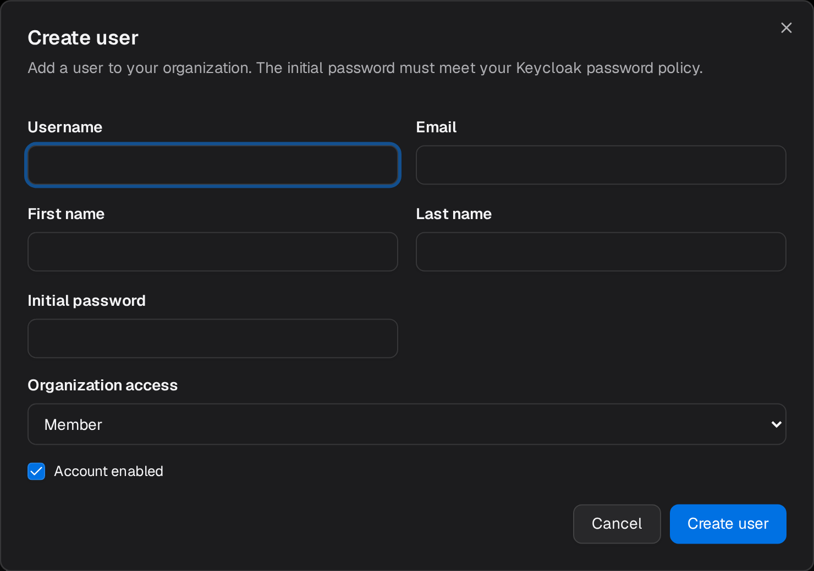
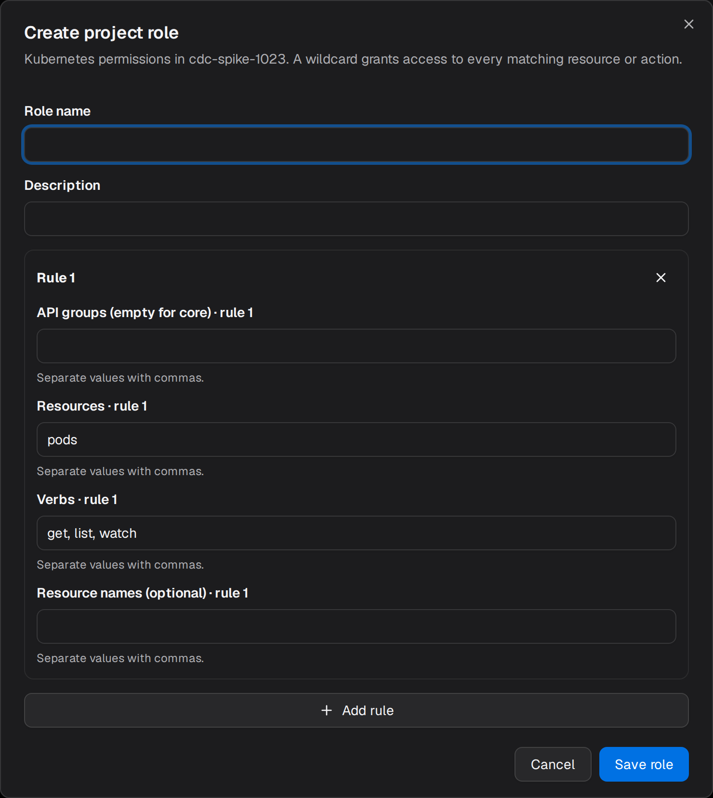

import {TeamAuthenticationDiagram} from '@site/src/components/Diagram/CloudFlowDiagrams';
import {OrganizationGroupLifecycleDiagram} from '@site/src/components/Diagram/CloudTopologyDiagrams';

# User and group management

Kube-DC separates Organization administration from Project access. Organization Admins manage members and Organization Groups, while Project roles control what those groups can do in each Project. Custom roles cover narrower requirements.

## Security model

Each Organization in Kube-DC has a **dedicated identity domain**:

- **Dedicated Keycloak Realm**: Every organization gets its own Keycloak realm, acting as an independent OIDC provider. Users from different organizations cannot share credentials or sessions.
- **Isolated JWT Tokens**: Authentication tokens are scoped to a single organization realm. A token issued for `acme` cannot be used to access `example` organization resources.
- **Separate Token Authentication**: Each realm has its own signing keys, token policies, and session management. Credentials and sessions are scoped to their issuing organization.
- **Kubernetes RBAC Integration**: JWT group claims are mapped to Kubernetes RoleBindings automatically. Access is enforced at the API server level, independent of the UI layer.

<details data-github-only>
<summary>Diagram source for GitHub</summary>

```
User authenticates  →  Organization Realm (OIDC)  →  JWT with Organization groups
                                                           ↓
                                            Kubernetes API validates JWT
                                                           ↓
                                          RoleBindings grant Project access
```

</details>

<TeamAuthenticationDiagram />

This model separates Organization identity and membership from Project workload access. Kubernetes RBAC is the authorization boundary; Project networking, quotas, and platform policy add workload isolation.

## Standard roles

When an organization and its projects are created, Kube-DC automatically provisions a set of standard roles. These cover the most common access scenarios without any manual configuration.

### Organization-level roles

The following table lists the two Organization roles. In the console, the
`org-admin` group shows as **Organization administrator** and the `user` group
shows as **Member**:

| Role | Group | Permissions |
|------|-------|-------------|
| `{org}-admin` | `org-admin` | Manage members, billing, shared quota, Projects, and Organization Groups within this Organization; receives `admin` in every Project |
| `{org}-user` | `user` | Read the Organization and Project list; receives `user` in every Project |

### Project-level roles

Every project receives these four roles automatically:

| Role | Description | Key Permissions |
|------|-------------|-----------------|
| `admin` | Project administration | Manage the supported namespaced resource set and namespaced RBAC; controller-owned quota objects remain read-only |
| `developer` | Workload management | Manage supported workloads, volumes, Services, and managed services; raw Kubernetes Secrets are read-only; no RBAC management |
| `project-manager` | Operations and oversight | Read and monitor Project resources, use the VM console, update selected managed security resources, and create or update KMS keys; no Project membership or quota management |
| `user` | Read-only access | Read Project resources and logs; no raw Secret access or VM console |

### Automatic role bindings

When a Project is created, Kube-DC configures these bindings:

| Subject | Role | Effect |
|---------|------|--------|
| `{org}:org-admin` | `admin` | Organization admins receive the standard `admin` role in every Project |
| `{org}:user` | `user` | Organization members receive the standard `user` role in every Project |

Additional Project roles, including `admin`, `developer`, and
`project-manager`, can be assigned through **Organization Groups**.

## Manage users

You need the Organization Admin role. To open the user list, open the account
menu, select **Manage organization**, and then click **Users**.

### User list

The **Members** tab lists every member of the Organization with the
**Organization access**, **Project groups**, **Status**, and **Joined**
columns. From this page you can:

- Click **Create user** to add a user to the Organization
- Use the **Manage groups** row action to grant or remove group access
- Use the **Delete user** row action to remove a user from the Organization
- Open the **Join requests** tab to review self-service join requests

:::info Permission required
Only users with the `org-admin` role can open Organization management and
create, delete, or change other users. Other members do not see the **Users**
page.
:::

If your provider manages members in an external portal, the **Users** page
says so. Then you add and remove members in that portal, and **Create user**,
**Delete user**, and the **Join requests** tab do not appear.

### Create a user

1. On the **Users** page, click **Create user**. The **Create user** dialog
   opens.
2. Fill in the fields that the following table describes.
3. Click **Create user**.



The following table describes the fields of the **Create user** dialog:

| Field | Description |
|-------|-------------|
| **Username** | Unique sign-in name |
| **Email** | The user's email address |
| **First name** | Given name |
| **Last name** | Family name |
| **Initial password** | The first password. It must meet the password policy of your Organization. |
| **Organization access** | **Member** (read-only access to every Project) or **Organization administrator** (Organization management and full Project access) |
| **Account enabled** | When selected, the user can sign in right after creation |

Kube-DC creates the user in the Organization's Keycloak realm. A **Member**
gets read-only access (the `user` role) to every Project. To grant more access,
add the user to an Organization Group.

### Manage the groups of a user

After you create a user, you can add the user to Organization Groups to grant
access to specific Projects.

1. In the **Users** list, open the row actions of the user.
2. Select **Manage groups**. The **Manage groups** dialog opens.
3. Select the groups to add, and clear the groups to remove. The list shows
   the base groups (`org-admin` and `user`) and your Organization Groups.
4. Click **Save groups**.

Group changes affect newly issued tokens. An access token that was already
issued keeps its existing group claims until it expires, which is 15 minutes
by default. To get the updated claims at once, the user signs out and signs in
again.

### Handle join requests

Users can ask to join an Organization from the console start page. See
[Sign up and sign in](sign-up-login.md). Organization Admins review these
requests on the **Join requests** tab.

1. On the **Users** page, click the **Join requests** tab. It lists each
   request with **Name**, **Email**, and **Requested** date.
2. Click **Approve** or **Deny** next to the request.
3. Optional: to approve, select the **Organization access** for the user:
   **Member** or **Organization administrator**.
4. Click **Approve** or **Deny** in the dialog to confirm.

### Delete a user

1. In the **Users** list, open the row actions of the user.
2. Select **Delete user**. The **Delete user** dialog opens.
3. Type the user name to confirm.
4. Click **Delete**.

Kube-DC removes the user from the Organization's Keycloak realm, which blocks
new sign-ins and token refresh. An access token that was already issued can
remain valid until its expiry, which is 15 minutes by default. The console does
not offer **Delete user** for the Organization owner.

## Organization groups

Organization Groups define elevated access per Project. Each group connects a Keycloak group claim to Kubernetes RoleBindings in the selected Projects' backing namespaces.

Use Organization Groups when you need to:

- Grant `admin`, `developer`, or `project-manager` access to specific Projects
- Manage teams: one group can span multiple Projects with a different role in each

### Create an Organization group in the console

1. Open Organization management, then click **Organization groups**.
2. Click **Create group**. The **Create organization group** dialog opens.
3. In **Group name**, enter a unique name for the group.
4. In **Display name**, enter the name that the console shows for the group.
5. Optional: enter a **Description**.
6. In **Project 1**, select the target Project.
7. Select one or more roles to grant in that Project, such as `admin`,
   `developer`, `project-manager`, or `user`.
8. Optional: to grant access to another Project, click **Add project access**
   and repeat steps 6 and 7.
9. Click **Create group**.

To add users to the group, use **Manage groups** on the **Users** page. See
[Manage the groups of a user](#manage-the-groups-of-a-user).

To change a group, use the **Edit group** row action, change the Project
access, and click **Save group**. To remove a group, use the **Delete group**
row action.

### Create an Organization group with kubectl

For infrastructure-as-code workflows, Organization Groups can be managed as Kubernetes CRDs:

```yaml
apiVersion: kube-dc.com/v1
kind: OrganizationGroup
metadata:
  name: backend-team        # Group name (also becomes the Keycloak group name)
  namespace: acme           # Organization namespace
spec:
  permissions:
  - project: production
    roles:
    - developer             # Manage supported workloads in 'production'
  - project: staging
    roles:
    - admin                 # Full admin access in 'staging'
  - project: monitoring
    roles:
    - project-manager       # Monitor resources and use approved management actions
```

Apply the group:

```bash
kubectl apply -f organization-group.yaml
```

When this resource is created, Kube-DC automatically:
1. Creates a Keycloak group `backend-team` in the organization's realm
2. Creates RoleBindings in each specified Project's backing namespace

:::important
- `OrganizationGroup` must be created in the **Organization API namespace**, not a Project backing namespace
- The group name must be unique within the organization
- Standard groups (`org-admin`, `user`) are managed automatically and cannot be overridden through OrganizationGroup
:::

### Controller lifecycle

<details data-github-only>
<summary>Diagram source for GitHub</summary>

```
OrganizationGroup created
    ├── Keycloak group created in organization realm
    ├── For each project in spec.permissions:
    │   └── RoleBinding created: {org}:{group-name} -> {role} in Project backing namespace
    └── New user tokens carrying the group claim receive that Project access

OrganizationGroup updated
    └── RoleBindings reconciled across all affected Project backing namespaces

OrganizationGroup deleted
    ├── Keycloak group removed
    └── All associated RoleBindings removed
```

</details>

<OrganizationGroupLifecycleDiagram />

## Custom Project roles

The four standard Project roles cover most scenarios. A holder of the Project `admin` role can create a custom Kubernetes Role when a narrower permission set is required.

### Create a role in the console

1. Open Organization management, then click **Project roles**.
2. In **Project**, select the Project for the role.
3. Click **Create role**. The **Create project role** dialog opens.
4. In **Role name**, enter a name for the role.
5. Optional: enter a **Description**.
6. Fill in the fields of **Rule 1**, separating values with commas:

   - **API groups (empty for core)**: the API groups, such as `apps` or
     `kubevirt.io`. Leave it empty for core resources such as pods and
     Services.
   - **Resources**: the resource types, such as `pods`, `configmaps`, or
     `services`.
   - **Verbs**: the allowed operations, such as `get`, `list`, `watch`,
     `create`, `update`, `patch`, or `delete`.
   - **Resource names (optional)**: limits the rule to named objects.

7. Optional: click **Add rule** to add another rule.
8. Click **Save role**.



To change a role, use the **Edit role** row action. The **Edit project role**
dialog opens the role as YAML. Change it and click **Save changes**. To remove a
role, use the **Delete role** row action.

### Create a custom Role with kubectl

```yaml
apiVersion: rbac.authorization.k8s.io/v1
kind: Role
metadata:
  name: ci-deployer
  namespace: acme-production     # Backing namespace: {org}-{project}
rules:
  - apiGroups: ["apps"]
    resources: ["deployments", "replicasets"]
    verbs: ["get", "list", "create", "update", "patch"]
  - apiGroups: [""]
    resources: ["pods", "services", "configmaps"]
    verbs: ["get", "list", "watch"]
```

:::warning Role Scope
Kubernetes Roles are namespace-scoped. To use the same custom role across multiple Projects, create it in every target Project's backing namespace before referencing it from an OrganizationGroup.
:::

After the role exists in the Project's backing namespace, reference it from an OrganizationGroup:

```yaml
spec:
  permissions:
  - project: production
    roles:
    - ci-deployer   # Custom role name
```

An Organization Group can bind a custom Role only if the Role grants nothing
beyond the four standard Project roles combined, so a group can never grant
more than naming those roles would. A Role that grants more, or one that
doesn't exist yet, is not bound. The OrganizationGroup then shows a
`RoleNotBindable` warning event naming the Role and the first permission it
exceeds. The group picks the Role up as soon as it exists or is narrowed.

## Permission reference

### Organization API scope

| Resource | `org-admin` | `user` |
|----------|-------------|--------|
| `organizations` | get, list, patch, update, watch | get |
| `projects` | full CRUD | get, list |
| `organizationgroups` | full CRUD | None |

### Project API scope

| Resource | `admin` | `developer` | `project-manager` | `user` |
|----------|---------|-------------|-------------------|--------|
| `virtualmachines` | full CRUD | full CRUD | get, list, watch | get, list |
| `pods` | create, get, list, watch, delete | create, get, list, watch, delete | get, list, watch | get, list |
| `pods/log` | get | get | get | get |
| VM console/VNC | ✅ | ✅ | ✅ | ❌ |
| `services` | full CRUD | full CRUD | get, list, watch | get, list |
| `deployments` | full CRUD | full CRUD | get, list, watch | get, list |
| `secrets` | full CRUD | get, list | get, list | ❌ |
| `configmaps` | full CRUD | full CRUD | get, list | get, list |
| `persistentvolumeclaims` | full CRUD | full CRUD | get, list, watch | get, list |
| RBAC (roles, bindings) | full CRUD | ❌ | ❌ | ❌ |
| Pod exec, attach, or port-forward | ❌ | ❌ | ❌ | ❌ |
| VM/VMI port-forward | ❌ | ❌ | ❌ | ❌ |
| `networkpolicies` | ❌ | ❌ | ❌ | ❌ |

## Troubleshooting

**User cannot sign in after creation**
- Check that the account is enabled: see the **Status** column in the **Users** list
- Check that the user enters the correct **Organization ID** on the console start page

**User can sign in but sees no Projects**
- The user may only have the `user` role, which provides read-only access
- Verify they are assigned to the correct organization group for elevated project access
- Verify the user belongs to the expected identity group and inspect the
  RoleBinding in the target Project's backing namespace

**Organization Group not granting access**
- Confirm the `OrganizationGroup` is created in the Organization API namespace, not a Project backing namespace
- Verify the project name in `spec.permissions` matches exactly (case-sensitive)
- Inspect the `OrganizationGroup` status and the RoleBindings in the target
  Project's backing namespace; reconciliation is asynchronous

**Permission changes not taking effect**
- Group membership is carried in the user's access token
- Sign out and sign in again to obtain updated claims immediately; otherwise, an existing token can retain old access until its default 15-minute expiry

**Custom role not appearing in Organization Group editor**
- The role must exist in the target Project's backing namespace before it can be referenced
- Create the role on the **Project roles** page or with `kubectl apply` first, then reference it from the OrganizationGroup

**Custom role selected but members have no access**
- Run `kubectl describe organizationgroup <name>` and look for a `RoleNotBindable` event
- Narrow the Role to permissions the standard Project roles grant, or create it if it doesn't exist; the group binds it automatically

