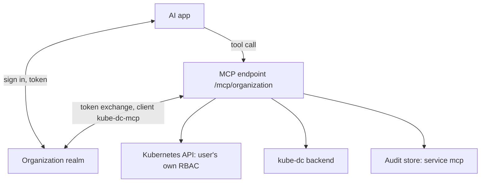
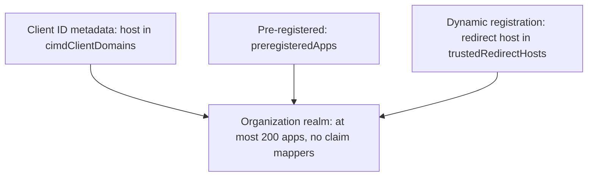
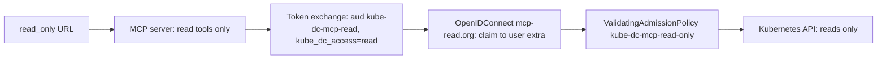

import {
  HostedMcpFlowDiagram,
  McpAppRegistrationDiagram,
  McpReadOnlyDiagram,
} from '@site/src/components/Diagram/HostedMcpDiagrams';

# Hosted MCP endpoint

This page is for operators who run a Kube-DC installation. After you read it,
you can enable the hosted Model Context Protocol (MCP) endpoint, control which
AI apps can register, make read-only sessions read-only in Kubernetes, and
monitor the endpoint.

The hosted MCP endpoint lets AI apps, such as Claude, VS Code, Cursor, and
ChatGPT, work in an Organization. An app connects to
`https://<backend-host>/mcp/<organization>`, the user signs in on the
Organization's Keycloak realm, and every tool runs with that user's own
Kubernetes permissions. The endpoint is off by default.

## How it works

The endpoint runs the MCP server of the backend image in its own Deployment,
`kube-dc-backend-mcp`. It uses Streamable HTTP without sessions, so it scales
like the API. It has no Kubernetes rights of its own.

<details data-github-only>
<summary>Diagram source for GitHub</summary>



</details>

<HostedMcpFlowDiagram />

The endpoint works in these steps:

1. It publishes OAuth Protected Resource Metadata (RFC 9728) that names the
   Organization's realm.
2. It accepts a token only from that realm, with the endpoint's URL in the
   audience and the `kube-dc:mcp` scope.
3. It never forwards the app's token to Kubernetes. The realm's confidential
   client `kube-dc-mcp` exchanges it (OAuth token exchange, RFC 8693) for a
   token of the same user. RBAC and the Kubernetes audit log see the person.
4. It caches the exchanged token until 30 seconds before the token expires.
5. It writes every tool call as an audit event in the backend's audit store
   (`backend.audit`): service `mcp`, the tool name as the action, the person,
   the app, and the Project. The app name comes from the manager's ConfigMap
   `kube-dc-mcp-app-names`.

The endpoint has three URL forms:

| URL | Use |
|---|---|
| `/mcp/<organization>` | All tools, for the whole Organization. |
| `/mcp/<organization>/<project>` | All tools, with `<project>` as the default for every tool's Project argument. It has its own Protected Resource Metadata and accepts the Organization's token. |
| Either URL followed by `/read_only` | Read tools only. The metadata lists only the `kube-dc:mcp:read` scope. A token with only that scope is refused on a full URL with `insufficient_scope`. |

The server instructions and tool descriptions steer apps to the platform
defaults: managed services for databases, caches, and queues (development plan
unless the user asks for production or HA), web traffic through the shared
Gateway (a `ClusterIP` Service with `expose-route`, no EIP), and public IPv4
only on request. `create_managed_service` uses the backend's own create path
with the user's exchanged token: the price quote
(`/api/billing/managed-quote`), the order check, and then the ServiceBinding.
`whoami` reports the `base_domain` of `master-config`, which is the domain of
route hostnames.

### Tools

The server offers 32 tools. A read-only URL offers only the eight read tools:

| Group | Tools |
|---|---|
| Read | `whoami`, `list`, `get_vm`, `get_quota`, `get_logs`, `get_resources`, `rollout_status`, `list_secrets` |
| Projects and VMs | `create_project`, `create_vm`, `vm_power`, `expose_vm`, `create_disk`, `attach_disk`, `detach_disk`, `restore_snapshot` |
| Networking and storage | `create_floating_ip`, `create_external_ip`, `create_bucket` |
| Apps and services | `deploy_app`, `create_managed_service`, `create_secret`, `run_job`, `schedule_job`, `restart`, `rollback`, `apply_manifest`, `extend_preview`, `create_webhook` |
| GitHub and registry | `connect_repository`, `registry_login` |
| Delete | `delete` |

`get_resources` masks Secret values unless the caller asks to reveal them. A
reveal is audited and is not available on a read-only URL. For
`connect_repository` and `registry_login`, see
[GitHub App](github-app.md).

## App registration

AI apps register in each Organization realm. The manager sets the rules for
every realm:

<details data-github-only>
<summary>Diagram source for GitHub</summary>



</details>

<McpAppRegistrationDiagram />

The three ways have these rules:

| Way | Rules |
|---|---|
| Client ID Metadata Documents | The metadata URL must be on a host in `backend.mcp.cimdClientDomains`. Default: `claude.ai`, `vscode.dev`, `code.visualstudio.com`, `antigravity.google`. |
| Pre-registered apps | `backend.mcp.preregisteredApps` are created in every realm under their metadata URL, because Keycloak cannot read their metadata document. Defaults: ChatGPT (`private_key_jwt` against its JWKS) and Codex (public client with PKCE). |
| Dynamic Client Registration | Every redirect URI must be on a host in `backend.mcp.trustedRedirectHosts`. Default: `localhost`, `127.0.0.1`, `claude.ai`, `claude.com`, `chatgpt.com`, `vscode.dev`, `cursor.com`, `www.cursor.com`, `anysphere.cursor-mcp` (the Cursor desktop callback), `global.consent.azure-apim.net` (Copilot Studio), and `callback.mistral.ai` (Le Chat). The app gets a consent screen, no claim mappers, and only the default scopes plus `kube-dc:mcp` and `kube-dc:mcp:read`. A realm holds at most 200 registered apps. |

Registered apps never get claim mappers. Only the platform's own client adds
the `org` claim that makes a token a Kubernetes credential.

For each realm, the manager creates the `kube-dc:mcp` and `kube-dc:mcp:read`
client scopes, the `kube-dc-mcp` client and its secret, and the registration
rules. It stores the client secrets in the Secret `kube-dc-mcp-requesters` in
the platform namespace, with one key for each Organization. It adds
`kube-dc:mcp:read` to every realm as a default optional scope, and to every app
that already has `kube-dc:mcp`.

## Enable the endpoint

1. Use Keycloak 26.6 or later with the experimental feature `cimd`. Add
   `cimd` to the features that the installation already enables. Do not
   replace the list, or you lose features such as
   `admin-fine-grained-authz:v1`. With Fleet, set `KEYCLOAK_FEATURES` in
   `cluster-config.env`, for example:

   ```bash
   KEYCLOAK_FEATURES=preview,organization,cimd
   ```

   Keycloak restarts one time.

2. Set the chart values:

   ```yaml
   backend:
     mcp:
       enabled: true
       # publicURL: https://backend.<domain>/mcp     (default)
       # replicaCount: 2
       # metricsPort: 9464
       # rateLimit: { perUser: 600, perAddress: 1200 } # requests a minute
       # trustedRedirectHosts, cimdClientDomains, preregisteredApps: chart defaults
   ```

   The backend's HTTPRoute routes the default URL (`/mcp` and
   `/.well-known/oauth-protected-resource/mcp`). A URL on another host needs a
   Gateway listener, a certificate, and its own route. The chart refuses a
   `publicURL` that is not `https`, or that has a query or a trailing slash.

3. Wait for the manager. It configures every Organization realm on its next
   reconcile, and the Secret `kube-dc-mcp-requesters` gets one key for each
   Organization. When a manager upgrade changes the realm setup, the manager
   configures every realm again on its next reconcile.

4. If a NetworkPolicy protects the audit Loki, admit
   `app.kubernetes.io/name: kube-dc-backend-mcp` next to the backend.
   Otherwise tool calls are not audited, and `KubeDcMcpAuditNotWritten` fires.

## Make read-only sessions read-only in Kubernetes

By default, the MCP server enforces read-only URLs: it offers only read tools.
Set `backend.mcp.enforceReadOnly: true` to make Kubernetes reject changes from
these sessions too. The manager and the backend must come from the same chart
version.

<details data-github-only>
<summary>Diagram source for GitHub</summary>



</details>

<McpReadOnlyDiagram />

With the setting on:

- A read-only session exchanges its token for the audience `kube-dc-mcp-read`
  with the scope `kube-dc:mcp-session-read`. This adds the claim
  `kube_dc_access=read`. The manager creates that client and scope in every
  realm.
- A second OpenIDConnect for each realm, `mcp-read.<organization>`, uses the
  realm's settings but accepts only that audience. It copies the claim to the
  user's extra, `gardener.cloud/user/kube_dc_access`. The realm's own
  OpenIDConnect and the `kube-dc` audience do not change, so no other token is
  affected.
- The ValidatingAdmissionPolicy `kube-dc-mcp-read-only` denies `CREATE`,
  `UPDATE`, `DELETE`, and `CONNECT` (exec, attach, port-forward) for a request
  with that extra.
- The MCP server fails closed. Without the read token, it refuses the session.
  It never uses a full token instead.

To check the setup, run these commands:

```bash
kubectl get openidconnect mcp-read.<organization>
kubectl get validatingadmissionpolicy kube-dc-mcp-read-only
```

To roll back, set `enforceReadOnly: false`. The manager stops creating the
entries, and removes them when it starts again.

## Operations

### Metrics and alerts

The MCP pods serve metrics on the port `metrics` (9464):

| Metric | Labels |
|---|---|
| `kube_dc_mcp_requests_total` | `status` |
| `kube_dc_mcp_request_duration_seconds` | `status` |
| `kube_dc_mcp_tool_calls_total` | `tool`, `result`, `access` |
| `kube_dc_mcp_tool_duration_seconds` | `tool`, `result` |
| `kube_dc_mcp_token_exchange_failures_total` | None |
| `kube_dc_mcp_auth_denied_total` | `status` (401, 403, or 429) |
| `kube_dc_mcp_audit_failures_total` | None |

With `backend.metrics.serviceMonitor.enabled` (default `true`), the chart adds
a ServiceMonitor and these warning alerts:

| Alert | Fires when |
|---|---|
| `KubeDcMcpNoMetrics` | Prometheus scrapes no ready MCP pod for 15 minutes. |
| `KubeDcMcpServerErrors` | More than 5% of requests answer 500 for 10 minutes. |
| `KubeDcMcpTokenExchangeFailing` | Token exchanges fail for 15 minutes. Check the realm's `kube-dc-mcp` client and the `kube-dc-mcp-requesters` Secret. |
| `KubeDcMcpAuditNotWritten` | Audit events could not be written in the last 15 minutes. Check the Loki NetworkPolicy and `LOKI_PUSH_URL`. |
| `KubeDcMcpToolErrors` | More than 20% of tool calls fail over 30 minutes, with more than 20 calls. |

### Rate limits

The server limits requests for each person and app, and for each client
address. The defaults are 600 and 1,200 requests a minute. Change them with
`backend.mcp.rateLimit`. A refused request gets HTTP 429 with `Retry-After`.

### Audit

The audit store receives every tool call (service `mcp`, the tool name as the
action) and every refused token (action `auth.denied`). Refused tokens are
recorded at most one time a minute for each Organization and address.

### Revoke an app

When you revoke an app in the realm, its sign-ins stop at once. Tokens that
the app already holds stay valid until they expire. The default is the
realm's access token lifespan, 15 minutes. Exchanged Kubernetes tokens also
stay valid until they expire.

## Verify the endpoint

To check a working endpoint:

- `curl https://<backend-host>/.well-known/oauth-protected-resource/mcp/<organization>`
  names `https://<keycloak-host>/realms/<organization>`.
- An unauthenticated `POST https://<backend-host>/mcp/<organization>` answers
  401 with `WWW-Authenticate: Bearer resource_metadata="<url>", scope="kube-dc:mcp"`.
- `kubectl -n kube-dc get pods -l app.kubernetes.io/component=mcp` shows the
  replicas as ready. The chart runs two replicas with a PodDisruptionBudget of
  `minAvailable: 1`.
- After a tool call, the Project's audit log in the console
  (**Security** → **Audit**) shows an `mcp` event that names the app.

## Protocol support

The server supports MCP revisions 2026-07-28 (stateless, with a per-request
envelope and `server/discover`), 2025-11-25, 2025-06-18, and 2025-03-26. It
uses the official TypeScript SDK v2 (`@modelcontextprotocol/server`). One URL
serves both:

- A 2025 request gets a separate server instance for each request, with JSON
  answers.
- A 2026-07-28 request goes through the SDK's per-request handler and is never
  streamed.

CORS allows the `Mcp-Method` and `Mcp-Name` headers of browser clients.
Keycloak's MCP support (Client ID Metadata Documents and resource indicators)
is experimental upstream. Pin the Keycloak version for each release.
