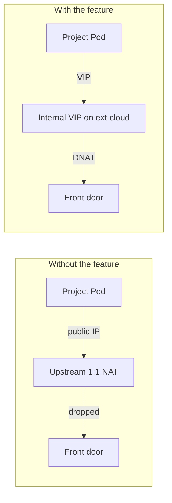
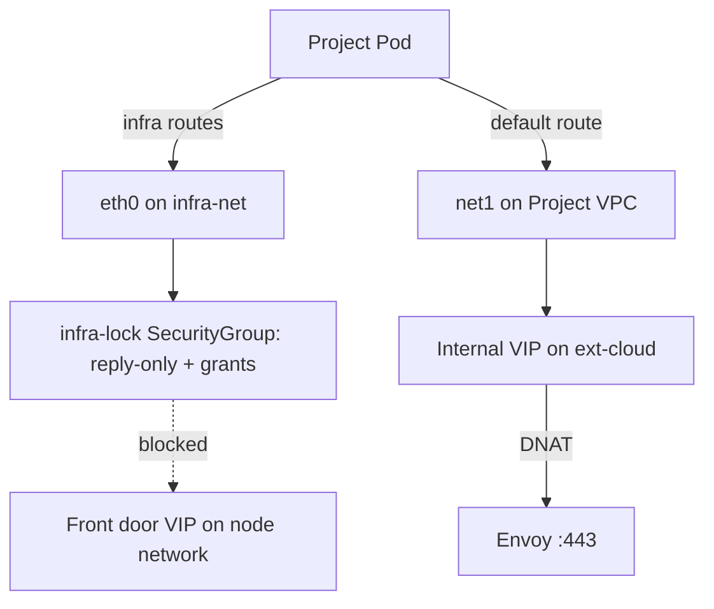
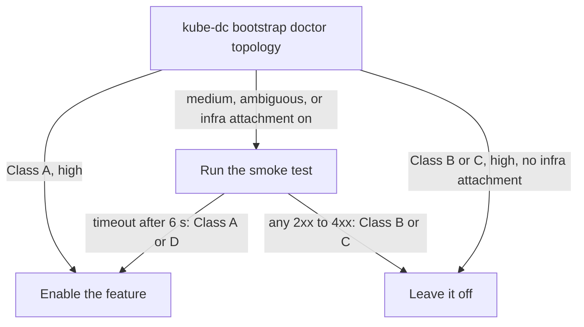
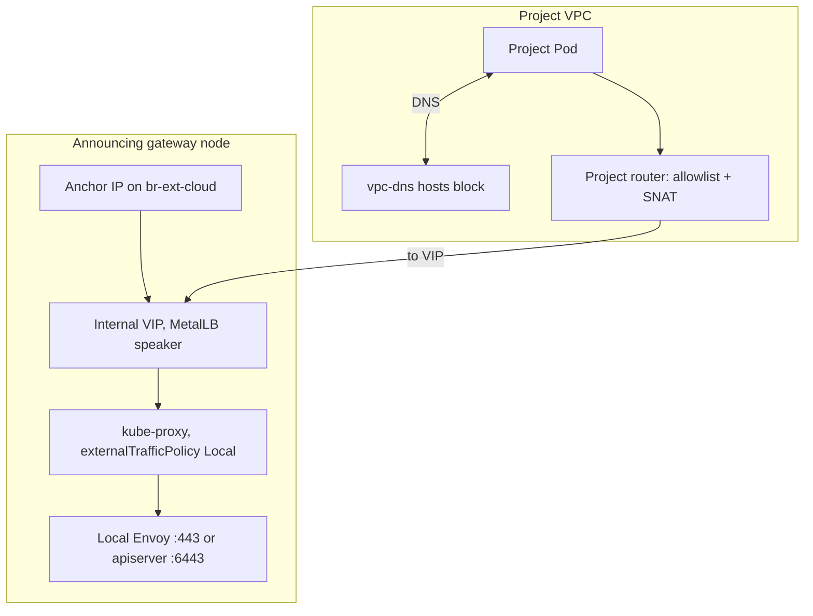
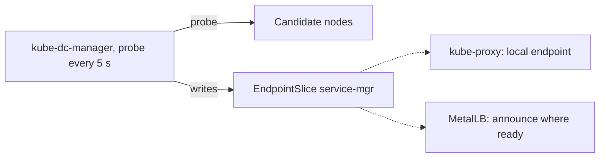
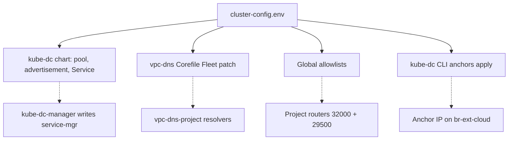

import {
  DualHomedPodDiagram,
  EndpointDecisionDiagram,
  EndpointMembershipDiagram,
  EndpointOwnershipDiagram,
  InternalEndpointDiagram,
  PlatformHairpinDiagram,
} from '@site/src/components/Diagram/InternalEndpointDiagrams';

# Internal platform endpoints

This page is for operators who run a Kube-DC management cluster. After you
read it, you can decide whether your cluster needs internal platform
endpoints, enable the feature, verify it, and operate it.

Project workloads call the platform's own public hostnames: Keycloak at
`login.<domain>`, the API at `backend.<domain>`, the console, S3, and the
Kubernetes API at `kube-api.<domain>`. On some networks, a Project Pod cannot
open a connection to the front-door address: an upstream NAT router drops the
packet, or the address is on a network interface that is locked for
Project Pods. Internal
platform endpoints give Project Pods a path to these hostnames that stays
inside the cluster. The feature is off by default.

The page has these sections:

| Section | Content |
|---|---|
| [What the feature does](#what-the-feature-does) | The problem and the two endpoints |
| [How Project Pods reach the platform](#how-project-pods-reach-the-platform) | Dual-homed Pods, which interface a destination uses, and Project DNS |
| [Do you need this?](#do-you-need-this) | The classifier, the four topology classes, and the smoke test |
| [How it works](#how-it-works) | Request path, backend health, anchors, DNS, and allowlists |
| [Enable the feature](#enable-the-feature) | What to configure, in order |
| [Verify the result](#verify-the-result) | Checks from a Project Pod and from the cluster |
| [Day-2 operations](#day-2-operations) | Hostnames, node drains, Envoy placement, anchors, rollback |
| [Troubleshooting](#troubleshooting) | Symptoms, causes, and fixes |
| [Configuration reference](#configuration-reference) | Chart values, cluster settings, and annotations |

## What the feature does

On a cluster behind an upstream 1:1 NAT router, public DNS gives a Project
Pod the cluster's public address. The router does not send that packet back
into the cluster, so the connection times out. The feature gives the
Project resolver an internal answer instead.

<details data-github-only>
<summary>Diagram source for GitHub</summary>



</details>

<PlatformHairpinDiagram />

The feature has two endpoints. Each one is a MetalLB VIP on the `ext-cloud`
network in front of a backend that runs on the cluster nodes:

| Endpoint | Backend | Hostnames | Default Service |
|---|---|---|---|
| `kubeAPI` | kube-apiserver on port 6443 | `kube-api.<domain>` | `kube-system/kube-api-platform` |
| `envoyGateway` | Envoy Gateway on port 443 | Every hostname that Envoy routes, for example `login`, `backend`, `console`, `s3`, and `bao` | `envoy-gateway-system/envoy-gateway-platform` |

You can enable each endpoint on its own. Clients outside the cluster, such as
a browser or a laptop `kubectl`, are not affected. Public DNS still points at
the public address.

## How Project Pods reach the platform

Read this section before you choose a class. The interface that a Project Pod
uses for a platform address decides whether Class B or Class D applies.

### Two network interfaces for each Project Pod

With infra attachment on (`INFRA_ATTACHMENT_ENABLED=true`), a Pod created in a
Project namespace gets two network interfaces. `kube-dc bootstrap init` turns
infra attachment on when it knows the node CIDR. The two interfaces are:

| Interface | Network | Routes | Policy |
|---|---|---|---|
| `net1` | The Project VPC subnet | The default route: the internet, the external network, and every address that the next row does not list | The Project VPC: SNAT and EIP, egress policy routes, Project and global allowlists |
| `eth0` | The shared infra subnet (`INFRA_ATTACHMENT_SUBNET`, default `infra-net`, CIDR `INFRA_ATTACHMENT_CIDR`, default `100.66.0.0/16`) | Only `INFRA_ATTACHMENT_ROUTES` (node subnet, join subnet, and Pod CIDR) and, for platform API clients, the management API ServiceIP | A per-Project Kube-OVN SecurityGroup, `infra-lock-<namespace>` |

The kernel chooses the interface by the longest matching prefix. A platform
address inside `INFRA_ATTACHMENT_ROUTES` goes out through `eth0`. Every other
address goes out through `net1`. The node subnet must use `eth0`, or kubelet
probe replies leave through the wrong interface. Host-network Pods and
KubeVirt `virt-launcher` Pods have one interface, and a VM sees only its
Project interface.

<details data-github-only>
<summary>Diagram source for GitHub</summary>



</details>

<DualHomedPodDiagram />

### The `eth0` lock

The SecurityGroup on `eth0` allows replies and a small set of exact grants.
The grants depend on the controller that owns the Pod:

| Role | Pods | New connections allowed on `eth0` |
|---|---|---|
| Workload | Ordinary Project Pods | Pods in the same Project. The front door (`<vip>:443`) only with `INFRA_ATTACHMENT_PLATFORM_INGRESS_WORKLOAD_EGRESS=true` |
| Management API client | Managed service engines, such as CNPG and MariaDB, and cloud-shell Jobs, when `MANAGEMENT_API_MODE=service`. In other modes they are workloads. | The management API ServiceIP on port 443, and workload Pods in the same Project |
| Control plane | Managed Cluster API servers and etcd backup Jobs | The cluster's etcd on TCP port 2379, and the front door `<vip>:443` when `INFRA_ATTACHMENT_PLATFORM_INGRESS_VIP` is set |
| Datastore | Managed Cluster etcd | etcd peers |

The SecurityGroup drops all other traffic that leaves `eth0`. A Project Pod
therefore reaches a platform hostname through `net1`, like a VM, unless the
hostname resolves to an address inside `INFRA_ATTACHMENT_ROUTES`. On `net1`,
the destination must also pass the Project's egress policy routes and
allowlists, and a node must announce it.

### Project DNS for Pods and VMs

Inside each Project VPC, the cluster DNS address (`CLUSTER_DNS`, for example
`10.101.0.11`) is a Kube-OVN SwitchLBRule to the Project's own resolver,
`vpc-dns-<project>` in `kube-system`. Pods and VMs in a Project both use this
resolver, and all the resolvers read the shared `vpc-dns-corefile` ConfigMap.
The `hosts` block in [Project DNS](#project-dns) therefore applies to Project
Pods and VMs. Platform Pods use `rke2-coredns` instead.

Managed GitHub runner workers are an exception. They use public resolvers and
a policy that denies private and CGNAT destinations unless the runner profile
grants them. A Project DNS rewrite does not apply to them. Their builds reach
the platform through the runner profile's platform endpoints.

## Do you need this?

### Run the classifier

To classify the cluster in your current kubeconfig, run this command:

```bash
kube-dc bootstrap doctor topology
```

Add `--kubeconfig <path>` to target another cluster. The command checks four
signals: existing platform-endpoint Services, a cloud-provider `providerID` on
the nodes, the Envoy Service `externalIPs`, and Envoy `hostNetwork`. It prints
a class, a verdict, and a confidence level, as in this example:

```
PROBE              DETAIL                                                                  CLASS HINT  CONFIDENCE
platform endpoints neither platform-endpoint Service present                               none        high
cloud-provider     no providerID on any node                                               none        high
Envoy externalIPs  externalIPs=[203.0.113.10] (svc type=LoadBalancer lb-class=metallb)    B           high
Envoy hostNetwork  false or unset (standard pod networking)                                none        none

Classification: Class B  (confidence: high)
Internal Platform Endpoints: not-needed
```

The verdict is one of `required`, `not-needed`, `already-enabled`, or
`ambiguous`. The classifier does not read `INFRA_ATTACHMENT_ROUTES`, so it
cannot report Class D. Use the verdict only when the confidence is `high` and
infra attachment is off. In every other case, run the smoke test in
[Run the smoke test](#run-the-smoke-test).

<details data-github-only>
<summary>Diagram source for GitHub</summary>



</details>

<EndpointDecisionDiagram />

`hostNetwork: true` is not a useful signal. Envoy binds the node's ports 80
and 443 on every cluster with the host-bind front door. The useful signal is
where the public address lives:

- **Layer `none`**: the node address is the front door. The Envoy Service
  type is `ClusterIP` and it carries `externalIPs`.
- **Layer `metallb-l2` or `metallb-bgp`**: a MetalLB VIP is the front door.
  The Envoy Service is `LoadBalancer` with `loadBalancerClass: metallb`, and
  `externalIPs` is empty.

`INGRESS_ADDRESS_LAYER` in `cluster-config.env` selects the layer.

### Topology classes

The class depends on whether a Project Pod can reach the public address from
inside the cluster:

| Class | Network | Feature |
|---|---|---|
| A | One public IP on an upstream router, translated 1:1 to private node IPs. Project Pods time out on `https://login.<domain>`, but external `kubectl` works. | Required. Without it, Project Pods cannot reach Keycloak, the console, or `kube-api.<domain>`. OIDC sign-in, the console Pod, and Managed Cluster control planes fail. |
| B | The public address is on a node interface, such as `br-ext-cloud`, in a broadcast domain that the nodes share. It is either a node address (layer `none`) or a MetalLB VIP in the same segment (layer `metallb-l2`). The address is outside `INFRA_ATTACHMENT_ROUTES`. | Not needed. Project traffic leaves through the Project's `ext-cloud` egress address and reaches the public address without an upstream router. |
| C | A cloud-provider load balancer serves the public hostnames, such as an AWS NLB, a GCP, Azure, or Hetzner load balancer. | Not needed. The provider load balancer handles the return path. |
| D | The front door is a MetalLB VIP or a node address on the node network, and `INFRA_ATTACHMENT_ROUTES` includes that network. Platform Pods, hosts, and Project VMs reach `https://login.<domain>`. Project Pods time out on every platform hostname: S3 buckets, managed database WAL archiving and backups, Keycloak OIDC from applications, the console API, and registry pushes. | Required. Give Project Pods a front door outside the infra routes: enable `envoyGateway` with a VIP on the external network, and map the platform hostnames to it in Project DNS. See [Class D](#class-d). |

### Class D

In Class D, the failure comes from the `eth0` lock, not from routing. The
hostname resolves to an address inside the infra routes, the Pod sends the
connection through `eth0`, and only the Managed Cluster control-plane role may
open connections to the front door there. A VM in the same Project has only
`net1`, so it reaches the front door.

`kube-dc bootstrap init` (CLI 0.9.17 and later) configures the internal front
door for an installation when all of these conditions are true:

- Managed services are on.
- The ingress layer is `metallb-l2`, and its VIP is inside the infra routes.
- Envoy runs on control-plane nodes, which are the endpoint's backends.

It then prints `front door <address> is inside the infra routes`. It reserves
the VIP and anchors after `EXT_NET_EXCLUDE_IPS`, adds the VIP to both global
allowlists, and makes Project DNS answer every name under the domain, except
`kube-api`, with the VIP. When Envoy runs on dedicated ingress workers, it
prints a `WARNING` and configures nothing. For the `none` and `metallb-bgp`
layers, it does nothing. In these cases, configure the endpoint by hand. The
command does not change an existing installation.

Managed Cluster control planes already reach the front door, because they hold
the front-door grant on `eth0`. When you add the internal endpoint, choose
their path. `INFRA_ATTACHMENT_PLATFORM_INGRESS_VIP` must stay an address
inside the infra routes, and the manager refuses an address outside them. You
can do one of these:

- Keep it at the node-network VIP, and let the control planes resolve `bao`
  and `s3` to that VIP.
- Move the control planes to the Project path. Then verify encrypted startup
  and etcd backups under the Project's egress policy.

### Run the smoke test

Run the test from an ordinary Pod in a Project namespace. Do not use a VM or a
host-network Pod: only a Pod with two interfaces shows Class D. Run these
commands:

```bash
PUBLIC_IP=$(getent hosts login.<domain> | awk '{print $1}')
echo "Public IP: $PUBLIC_IP"
curl -sk -m 6 -o /dev/null -w "HTTP=%{http_code}\n" \
  https://login.<domain>/realms/master/.well-known/openid-configuration
```

Replace `<domain>` with the platform domain. Read the result with this table:

| Result | Class | Action |
|---|---|---|
| `HTTP=` followed by any 2xx, 3xx, or 4xx code, well under 6 s | B or C | Leave the feature off. |
| No answer, timeout at 6 s | A or D | Enable the feature. It is Class D when `ip route get $PUBLIC_IP` in the Pod shows `dev eth0`. |

If you cannot run a Pod in a Project namespace, run these commands on a
control-plane node instead:

```bash
ip -4 -br addr show br-ext-cloud   # Is a routable public IP on the bridge?
ip -4 route get $PUBLIC_IP         # Does the route use dev br-ext-cloud?
```

If both answers are yes, the cluster is Class B, unless the address is inside
`INFRA_ATTACHMENT_ROUTES`. In that case it is Class D. If no node has the public
IP and the route goes through an upstream gateway that you do not control,
the cluster is probably Class A.

## How it works

### Request path

A Project Pod resolves a platform hostname through its Project resolver and
receives the internal VIP. The Project router lets the VIP through and sends
the traffic onto the `ext-cloud` network. One node announces the VIP, and
kube-proxy on that node forwards the connection to the backend on the same
node.

<details data-github-only>
<summary>Diagram source for GitHub</summary>



</details>

<InternalEndpointDiagram />

Each endpoint Service is a selectorless `LoadBalancer` Service with
`externalTrafficPolicy: Local`. Because of `Local`, MetalLB announces the VIP
only from a node that has a ready backend, and kube-proxy never forwards to
another node. This matters where node-to-node traffic on port 443 is blocked.

### Backend health

kube-dc-manager owns the Service's backend list. It lists the Nodes that match
the backend node selector and probes each node's `InternalIP`:

- **`kubeAPI`**: `GET https://<node-ip>:6443/readyz`. A 401 answer counts as
  healthy, because it proves that the API server runs.
- **`envoyGateway`**: `GET https://<node-ip>:443/` with the probe hostname as
  TLS SNI and HTTP `Host`. Any answer below 500 counts as healthy.

The manager writes the healthy addresses into an EndpointSlice named
`<service>-mgr`. Each endpoint carries its node name. kube-proxy and MetalLB
both read this slice.

<details data-github-only>
<summary>Diagram source for GitHub</summary>



</details>

<EndpointMembershipDiagram />

The manager applies these rules on every probe cycle:

| Condition | Result |
|---|---|
| One successful probe | The backend is added to the slice. |
| Two failed probes in a row | The backend is removed from the slice, about 10 to 15 s after it stops. |
| Every candidate fails | The manager keeps the last good endpoints that are still candidates, and records an `AllBackendsUnhealthy` event. |
| No Node matches the selector | The manager empties the slice and records a `NoCandidates` event. |
| The manager stops | The slice keeps its last content. Traffic continues. |

### Anchor IPs

MetalLB in layer-2 mode announces the VIP with gratuitous ARP from the elected
speaker. The kernel sends that ARP only when the node has its own address on
the announcing interface. An anchor IP is that address: one host IP for each
gateway node, bound to `br-ext-cloud` by the systemd unit
`kube-dc-anchor.service`. Without an anchor, MetalLB reports the VIP as
announced, but no other device on the segment receives the announcement.

`kube-dc bootstrap anchors apply <cluster>` installs the units and
`kube-dc bootstrap doctor anchors <cluster>` checks them. Both commands read
`EXT_NET_ANCHOR_IPS` from the cluster's `cluster-config.env`. For the CLI
workflow, see [Fleet CLI](cluster-cli-fleet.md).

:::danger Anchor IPs must not collide with OVN router-port IPs
If an anchor IP is also an OVN logical-router-port IP, the host and OVN both
answer ARP for it. The upstream router then switches between two MAC
addresses and drops return traffic for Project egress. The worst case is the
`ovn-cluster-ext-cloud` port, which carries the egress address of the
management VPC. A collision there causes repeated outages of controller
traffic to Project EIPs.

Before you choose anchor IPs, list the router-port IPs in use:

```bash
kubectl -n kube-system exec deploy/ovn-central -c ovn-central -- \
  ovn-nbctl --columns=name,networks list logical_router_port | grep '<ext-net-cidr>'
```

Replace `<ext-net-cidr>` with the `ext-cloud` CIDR. Choose anchors from
`EXT_NET_EXCLUDE_IPS` that are not in this list. To repair a cluster that
already has a collision, contact Kube-DC support. The repair is
cluster-specific and interrupts traffic.
:::

### Probe hostname for `envoyGateway`

Envoy closes a TLS handshake whose SNI matches no Gateway listener, so a probe
to the bare node IP fails with `connection reset by peer`. Set
`platformEndpoints.envoyGateway.backend.health.host` to a hostname that Envoy
serves with an `HTTPRoute`.

Do not use `kube-api.<domain>`. It is a `TLSRoute` that passes TLS through to
the API server, so the probe receives the API server certificate instead of
an Envoy answer. The Fleet default is `console.<domain>`, which every Kube-DC
cluster serves. `backend.<domain>` and `login.<domain>` also work.

### Project DNS

Each Project VPC runs its own CoreDNS Deployment, `vpc-dns-<project>`, in
`kube-system`. Project Pods and VMs use only this resolver (see
[Project DNS for Pods and VMs](#project-dns-for-pods-and-vms)). All of these
Deployments read the `kube-system/vpc-dns-corefile` ConfigMap. A `hosts` block
in that Corefile maps the platform hostnames to the VIPs:

```corefile
hosts {
    <kube-api-vip> kube-api.<domain>
    <envoy-gateway-vip> login.<domain> backend.<domain> console.<domain> admin.<domain> billing.<domain> bao.<domain> grafana.<domain> s3.<domain> recovery.<domain> registry.<domain>
    fallthrough
}
```

Replace `<kube-api-vip>` and `<envoy-gateway-vip>` with the two VIPs. Put
every hostname that a Project workload can call in the list:

| Hostname | Called from Projects by |
|---|---|
| `s3` | Managed database WAL archiving and backups, application buckets, and Managed Cluster etcd backups |
| `recovery` | Managed service restores into shared Projects |
| `registry` | Builds that push to the managed registry |
| `bao` | The Managed Cluster KMS plugin, for etcd encryption |
| `login` | OIDC from applications and Managed Clusters |
| `console`, `backend`, `admin`, `billing`, `grafana` | The CLI, the cloud shell, and API clients inside Projects |

A hostname that is missing from the list resolves through public DNS and
fails as if the feature were off. A fixed list does not cover generated
names: each managed registry (`<instance>-<namespace>.<domain>`) and each
Service exposed through the Gateway gets its own hostname. If Projects call
those names over HTTPS, answer the whole zone with the internal VIP instead
of a list. Use a CoreDNS `template` for `<domain>`, and map `kube-api` before
it. The internal endpoint serves port 443 only.

The cluster CoreDNS (`rke2-coredns`) is a different resolver. It serves
platform Pods, not Project Pods. A rewrite there does not change Project DNS.

### Project router allowlists

A Project router drops traffic to `ext-cloud` addresses that it does not know.
Put both VIPs in `INGRESS_GLOBAL_ALLOWLIST` and in `EGRESS_GLOBAL_ALLOWLIST`.
The manager writes them as allow rules at priorities 32000 and 29500, ahead of
the egress deny rule at priority 29000. Anchor IPs do not need an allowlist
entry for this feature, because ARP does not pass through router policies.

## Enable the feature

This section is for a Class A or Class D cluster. For Class B and Class C,
leave the feature off. On a Class D installation that `kube-dc bootstrap init`
configured, check the result with [Verify the result](#verify-the-result)
instead.

### What you configure

One set of values in `cluster-config.env` feeds four separate mechanisms. Use
the same VIPs everywhere.

<details data-github-only>
<summary>Diagram source for GitHub</summary>



</details>

<EndpointOwnershipDiagram />

### 1. Choose two VIPs

Choose two addresses in the `ext-cloud` subnet that no Project EIp or system
SNAT uses. Adjacent addresses keep the allowlists short. This page uses
`100.64.0.30` for `kubeAPI` and `100.64.0.31` for `envoyGateway`.

### 2. Reserve the VIPs in IPAM

Add the VIPs to `EXT_NET_EXCLUDE_IPS` in `cluster-config.env`, so Kube-OVN
does not give them to Projects. A range is written `<first>..<last>`:

```bash
EXT_NET_EXCLUDE_IPS=100.64.0.1..100.64.0.31
```

### 3. Add the VIPs to both allowlists

Add both VIPs to the two global allowlists in `cluster-config.env`:

```bash
INGRESS_GLOBAL_ALLOWLIST=["<existing>","100.64.0.30","100.64.0.31"]
EGRESS_GLOBAL_ALLOWLIST=["<existing>","100.64.0.30","100.64.0.31"]
```

Replace `<existing>` with the entries that the lists already hold.

### 4. Turn on the endpoints

With Fleet, set the switches and VIPs in `cluster-config.env`:

```bash
PLATFORM_ENDPOINT_KUBE_API_ENABLED=true
KUBE_API_INTERNAL_VIP=100.64.0.30
PLATFORM_ENDPOINT_ENVOY_GATEWAY_ENABLED=true
ENVOY_GATEWAY_INTERNAL_VIP=100.64.0.31
```

The Fleet HelmRelease passes these values to the chart. It also sets
`health.host` to `console.<domain>`, the advertisement mode from
`METALLB_MODE`, and announcement on nodes labeled
`ovn.kubernetes.io/external-gw: "true"`.

Without Fleet, set the chart values directly:

```yaml
platformEndpoints:
  kubeAPI:
    enabled: true
    vip: "100.64.0.30"
  envoyGateway:
    enabled: true
    vip: "100.64.0.31"
    backend:
      health:
        host: "console.<domain>"
```

The chart refuses to render when an enabled endpoint has no `vip`.

### 5. Add the hostnames to Project DNS

Add the `hosts` block from [Project DNS](#project-dns) to the `.:53` server
block of the `vpc-dns-corefile` ConfigMap. With Fleet, put it in the
per-cluster patch of that ConfigMap. Without Fleet, edit the ConfigMap.

### 6. Restart the Project resolvers

Restart every `vpc-dns-*` Deployment, so each resolver loads the changed
Corefile:

```bash
kubectl -n kube-system get deploy -o name | grep '^deployment.apps/vpc-dns-' | \
  xargs -I{} kubectl -n kube-system rollout restart {}

kubectl -n kube-system get deploy -o name | grep '^deployment.apps/vpc-dns-' | \
  xargs -I{} kubectl -n kube-system rollout status {} --timeout=120s
```

### 7. Install the anchors

Set `EXT_NET_ANCHOR_IPS` and `EXT_NET_ANCHOR_SSH_HOSTS` in
`cluster-config.env` (see [Cluster settings](#cluster-settings)). Then install
and check the anchor units:

```bash
kube-dc bootstrap anchors apply <cluster>
kube-dc bootstrap doctor anchors <cluster>
```

Replace `<cluster>` with the cluster name in the Fleet repository. Every row
of the doctor output must be green.

## Verify the result

From a Pod in a Project namespace, check DNS and both endpoints:

```bash
nslookup kube-api.<domain>     # expect the kubeAPI VIP
nslookup login.<domain>        # expect the envoyGateway VIP

curl -sk https://kube-api.<domain>:6443/readyz
# expect HTTP 401: the API server answers and asks for authentication

curl -sk https://console.<domain>/
curl -sk https://login.<domain>/realms/master/.well-known/openid-configuration
curl -sk https://backend.<domain>/healthz
# expect HTTP 200 from each
```

From an administrator workstation, check the slices, the announced VIPs, and
the manager events:

```bash
kubectl -n kube-system get endpointslice kube-api-platform-mgr \
  -o jsonpath='{range .endpoints[*]}{.addresses[0]} node={.nodeName} ready={.conditions.ready}{"\n"}{end}'
kubectl -n envoy-gateway-system get endpointslice envoy-gateway-platform-mgr \
  -o jsonpath='{range .endpoints[*]}{.addresses[0]} node={.nodeName} ready={.conditions.ready}{"\n"}{end}'

kubectl -n kube-system get svc kube-api-platform -o jsonpath='{.status.loadBalancer}'
kubectl -n envoy-gateway-system get svc envoy-gateway-platform -o jsonpath='{.status.loadBalancer}'

kubectl -n kube-system describe svc kube-api-platform | tail -30
kubectl -n envoy-gateway-system describe svc envoy-gateway-platform | tail -30
```

Each slice must list every backend node as ready. The Service events show
`BackendHealthy` and `EndpointsUpdated`.

## Day-2 operations

### Add a hostname behind `envoyGateway`

Envoy routes every added `HTTPRoute` hostname through the same VIP, for example
`status.<domain>`. Project DNS must still resolve the added name to the VIP. Add
the name to the `envoyGateway` line of the Corefile `hosts` block:

```diff
 hosts {
     100.64.0.30 kube-api.example.com
-    100.64.0.31 login.example.com backend.example.com console.example.com admin.example.com billing.example.com bao.example.com grafana.example.com s3.example.com recovery.example.com registry.example.com
+    100.64.0.31 login.example.com backend.example.com console.example.com admin.example.com billing.example.com bao.example.com grafana.example.com s3.example.com recovery.example.com registry.example.com status.example.com
     fallthrough
 }
```

Then restart the resolvers as in
[Restart the Project resolvers](#6-restart-the-project-resolvers).

### Drain a node

Envoy runs three replicas, one on each ingress node. The `envoy-data-plane`
PodDisruptionBudget keeps at least two of them during a drain:

```bash
kubectl drain <node> --ignore-daemonsets --delete-emptydir-data
```

The manager removes the drained node from the slice in 10 to 15 seconds. If
the drained node announced the VIP, MetalLB moves the VIP to another node.
Project clients see one or two reconnects during that move, for about 6
seconds. After you uncordon the node, the manager adds it back.

### Move Envoy to other nodes

The `envoyGateway` backend selector is `node-role.kubernetes.io/control-plane`
by default, because Envoy runs on the control-plane nodes in the default
layout. Nothing checks that the two match. If you move Envoy to dedicated
ingress nodes, for example with `--ingress-node`, set
`platformEndpoints.envoyGateway.backend.nodeSelector` to the labels of those
nodes. Otherwise the slice keeps only nodes without Envoy, every probe fails,
and Project Pods lose the path while the platform reports healthy.

`kube-dc bootstrap accept` reports the readiness of the platform endpoints, so
it detects this mismatch after the change.

### Replace an anchor IP

To give an anchor IP a different use, for example when you retire a node:

1. Drain the node that holds the old anchor.
2. Set the replacement address in `EXT_NET_ANCHOR_IPS`.
3. Run `kube-dc bootstrap anchors apply <cluster>`.
4. Run `kube-dc bootstrap doctor anchors <cluster>` and confirm that every
   row is green.

### Disable the feature

Disable the feature only when Project Pods can reach the public address. The
order of the steps is important:

1. Remove the platform hostnames from the Corefile `hosts` block. Keep
   `fallthrough`, so names resolve through public DNS:

   ```diff
    hosts {
   -    100.64.0.30 kube-api.example.com
   -    100.64.0.31 login.example.com backend.example.com console.example.com admin.example.com billing.example.com bao.example.com grafana.example.com s3.example.com recovery.example.com registry.example.com
        fallthrough
    }
   ```

   Restart the resolvers. Then wait at least 5 minutes, so client caches
   resolve the public addresses again.

2. Run the [smoke test](#run-the-smoke-test) from a Project Pod. If it times
   out, the cluster is Class A. Stop, and restore the `hosts` block.

3. Turn off both endpoints:

   ```yaml
   platformEndpoints:
     kubeAPI:
       enabled: false
     envoyGateway:
       enabled: false
   ```

   After Flux applies the change, the chart removes the `IPAddressPool`, the
   advertisement, and the Service. Kubernetes deletes the `<service>-mgr`
   slice with its Service, and the manager stops the probes.

4. Remove the VIPs from `INGRESS_GLOBAL_ALLOWLIST` and
   `EGRESS_GLOBAL_ALLOWLIST`. The manager removes them from the Project
   routers on its next reconcile.

5. Optional: remove the VIPs from `EXT_NET_EXCLUDE_IPS`. If you keep them, the
   only cost is two unused addresses.

6. Keep the anchor units while any other `LoadBalancer` Service uses MetalLB.
   The anchors are not specific to this feature. Remove them only when you
   remove MetalLB.

You can undo steps 1 to 5 at any time. Step 6 has the largest effect: an
anchor removed from a node that announces other MetalLB VIPs stops those
announcements.

## Troubleshooting

This table lists common symptoms:

| Symptom | Cause | Fix |
|---|---|---|
| `connection refused` to a VIP | The slice has no ready backend. | Read the Service events and the manager log: `kubectl -n kube-dc logs deploy/kube-dc-manager \| grep platform-endpoint`. Look for a NetworkPolicy that blocks the manager from the nodes, or a wrong `health.host`. |
| `connection reset by peer` to the `envoyGateway` VIP | `health.host` is a `TLSRoute` hostname, most often `kube-api.<domain>`. | Set `health.host` to `console.<domain>` or another `HTTPRoute` hostname. |
| Timeout to a VIP while the backends are healthy | The VIP is missing from one of the global allowlists, so the Project router drops the packet. | Add the VIP to both allowlists. Check with `kubectl ko nbctl lr-policy-list <project-router>`: the VIP must be in the 32000 and 29500 allow rules. |
| A Project VM reaches a platform hostname, but a Project Pod times out | Class D: the address is inside `INFRA_ATTACHMENT_ROUTES`, so the Pod uses the locked `eth0`. `ip route get <address>` in the Pod shows `dev eth0`. | Enable `envoyGateway` with a VIP on the external network, and map the hostnames to it in Project DNS. See [Class D](#class-d). |
| `nslookup` from a Project Pod returns the public address | The `vpc-dns-<project>` Deployment did not load the changed Corefile, or the name is not in the `hosts` block. | Check the ConfigMap, then run `kubectl -n kube-system rollout restart deploy/vpc-dns-<project>`. |
| The Service has no address and stays pending | `loadBalancerClass` does not match the `--lb-class` flag of the MetalLB controller. | Set `loadBalancerClass` to the value that MetalLB uses. The default is `metallb`. |
| MetalLB does not announce the VIP | No anchor on the node, or no node is both a speaker candidate and a ready backend. | Run `kube-dc bootstrap doctor anchors <cluster>`. Check that `advNodeSelectors` and the backend `nodeSelector` select at least one common node. |
| A `NoCandidates` event and an empty slice | The backend `nodeSelector` matches no Node. | Correct the selector. For `envoyGateway`, select the nodes where Envoy runs. |
| The slice has fewer backends than expected | Envoy does not run on every selected node, so the probes to the other nodes fail. | Run Envoy on every selected node, or narrow the selector to the Envoy nodes. |

If the problem continues, contact Kube-DC support. Include the manager log
lines for `platform-endpoint` and the output of
`kube-dc bootstrap doctor anchors <cluster>`.

## Configuration reference

### Chart values

The `platformEndpoints` values in `charts/kube-dc/values.yaml` have these
defaults. Both endpoints take the same keys:

```yaml
platformEndpoints:
  kubeAPI:
    enabled: false
    name: kube-api-platform          # Service name; the slice is <name>-mgr
    namespace: kube-system
    vip: ""                          # required when enabled
    pool: kube-api-platform          # MetalLB IPAddressPool name
    advertisementMode: l2            # l2 (ARP on `interface`) or bgp (/32 to BGPPeers)
    interface: br-ext-cloud          # l2 mode only
    bgpPeers: []                     # bgp mode only; empty means all peers
    advNodeSelectors: []             # nodes that may announce the VIP
    loadBalancerClass: metallb       # must match the MetalLB --lb-class flag
    port: 6443
    sessionAffinity: ""
    backend:
      mode: node-control-plane       # the only supported mode
      nodeSelector:
        node-role.kubernetes.io/control-plane: ""   # empty value: the label exists
      addressType: InternalIP        # InternalIP, ExternalIP, or Hostname
      health:
        scheme: https
        path: /readyz
        port: 6443
        intervalSeconds: 5
        timeoutSeconds: 3
        failureThreshold: 2
        successThreshold: 1
        insecureSkipVerify: true     # the API server certificate does not name the node IP
        statusMax: 499               # 401 from /readyz counts as healthy

  envoyGateway:
    enabled: false
    name: envoy-gateway-platform
    namespace: envoy-gateway-system
    vip: ""                          # required when enabled
    pool: envoy-gateway-platform
    advertisementMode: l2
    interface: br-ext-cloud
    bgpPeers: []
    advNodeSelectors: []
    loadBalancerClass: metallb
    port: 443
    sessionAffinity: ""
    backend:
      mode: node-control-plane
      nodeSelector:
        node-role.kubernetes.io/control-plane: ""   # must select the nodes where Envoy runs
      addressType: InternalIP
      health:
        scheme: https
        path: /
        port: 443
        host: ""                     # required: an HTTPRoute hostname, sent as SNI and Host
        intervalSeconds: 5
        timeoutSeconds: 3
        failureThreshold: 2
        successThreshold: 1
        insecureSkipVerify: true
        statusMax: 499               # Envoy answers 302, 404, or 421 on many paths
```

`l2AdvNodeSelectors` is an older name for `advNodeSelectors`. The chart still
reads it when `advNodeSelectors` is empty.

### Cluster settings

These `cluster-config.env` keys control the feature on a Fleet cluster:

| Key | Purpose | Example |
|---|---|---|
| `PLATFORM_ENDPOINT_KUBE_API_ENABLED` | Turns on `kubeAPI`. | `true` |
| `KUBE_API_INTERNAL_VIP` | The `kubeAPI` VIP. | `100.64.0.30` |
| `PLATFORM_ENDPOINT_ENVOY_GATEWAY_ENABLED` | Turns on `envoyGateway`. | `true` |
| `ENVOY_GATEWAY_INTERNAL_VIP` | The `envoyGateway` VIP. | `100.64.0.31` |
| `METALLB_MODE` | The advertisement mode for both endpoints. | `l2` |
| `EXT_NET_EXCLUDE_IPS` | Addresses that Kube-OVN does not give to Projects. Must include the VIPs and the anchors. | `100.64.0.1..100.64.0.31` |
| `INGRESS_GLOBAL_ALLOWLIST` | Allowed `ext-cloud` addresses for Project ingress. Must include both VIPs. | `["100.64.0.30","100.64.0.31"]` |
| `EGRESS_GLOBAL_ALLOWLIST` | Allowed `ext-cloud` addresses for Project egress. Must include both VIPs. | `["100.64.0.30","100.64.0.31"]` |
| `EXT_NET_ANCHOR_IPS` | One anchor for each gateway node, as `<node>=<ip>/<prefix>`. | `node-1=100.64.0.11/16,node-2=100.64.0.12/16` |
| `EXT_NET_ANCHOR_INTERFACE` | The bridge for the anchors. | `br-ext-cloud` |
| `EXT_NET_ANCHOR_SSH_HOSTS` | The SSH address of each gateway node, for `anchors apply`. | `node-1=192.0.2.11,node-2=192.0.2.12` |
| `EXT_NET_ANCHOR_REQUIRED` | Makes `anchors apply` fail when `EXT_NET_ANCHOR_IPS` is empty. | `true` |

### Service annotations

The chart writes these annotations on each endpoint Service, and
kube-dc-manager reads them. The default applies when an annotation is
missing:

| Annotation | Purpose | Default |
|---|---|---|
| `kube-dc.com/backend-source` | Selects the Service for the manager. The only value is `node-control-plane`. | None (required) |
| `kube-dc.com/backend-node-selector` | Node labels as `key=value,key2=value2`. An empty value means the label exists. | `node-role.kubernetes.io/control-plane=` |
| `kube-dc.com/backend-address-type` | The node address to use: `InternalIP`, `ExternalIP`, or `Hostname`. | `InternalIP` |
| `kube-dc.com/health-scheme` | `http` or `https`. | `https` |
| `kube-dc.com/health-path` | The probe path. | `/readyz` |
| `kube-dc.com/health-port` | The probe port. | The Service target port |
| `kube-dc.com/health-host` | The TLS SNI and HTTP `Host` of the probe. | The node IP |
| `kube-dc.com/health-interval-seconds` | The time between probes. | `5` |
| `kube-dc.com/health-timeout-seconds` | The timeout of one probe. | `3` |
| `kube-dc.com/health-failure-threshold` | Failures in a row before removal. | `2` |
| `kube-dc.com/health-success-threshold` | Successes in a row before addition. | `1` |
| `kube-dc.com/health-insecure-skip-verify` | Skips TLS certificate checks on the probe. | `true` |
| `kube-dc.com/health-status-max` | The highest HTTP code that counts as healthy, from 200 to 599. | `399` (the chart sets `499`) |

## Related pages

- [Networking architecture](architecture-networking.md): VPCs, subnets, and
  the OVN logical layout.
- [External networks](networking-external.md): add external networks such as
  `ext-public`.
- [MetalLB HA](deploy-metallb-ha.md): install MetalLB for the public front
  door.
- [Fleet CLI](cluster-cli-fleet.md): the Fleet workflow, including
  `bootstrap anchors`.
